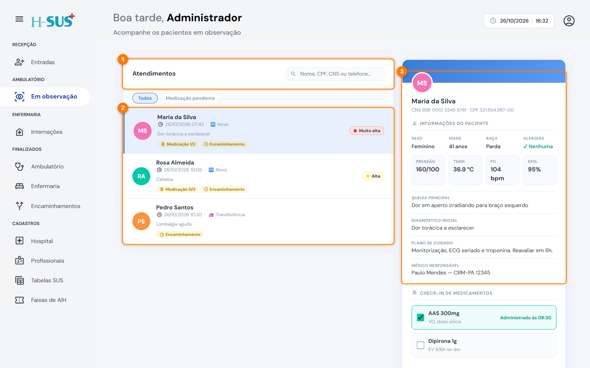
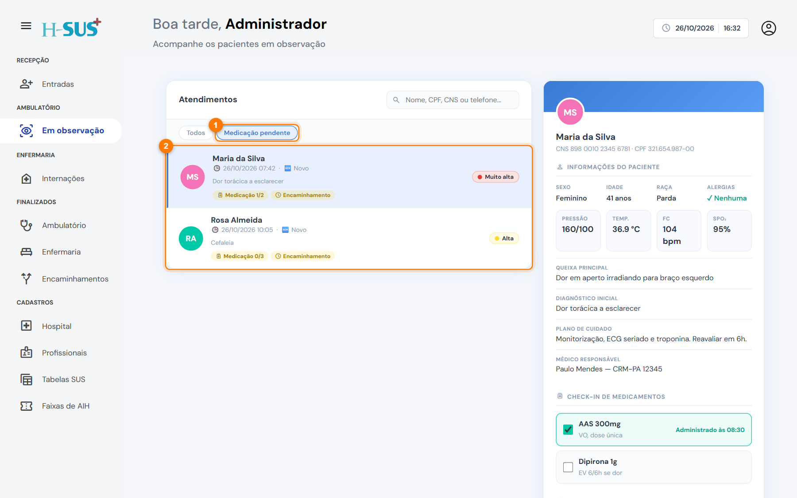
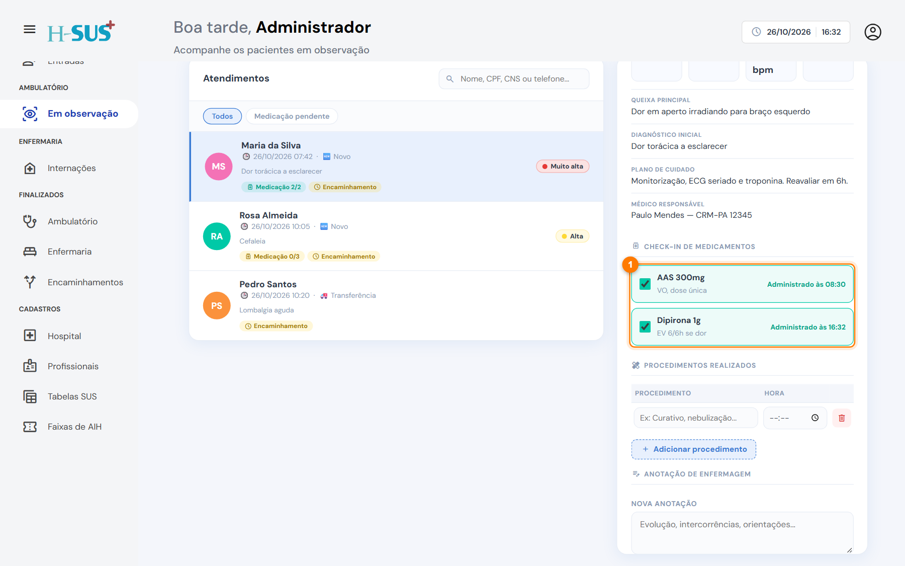
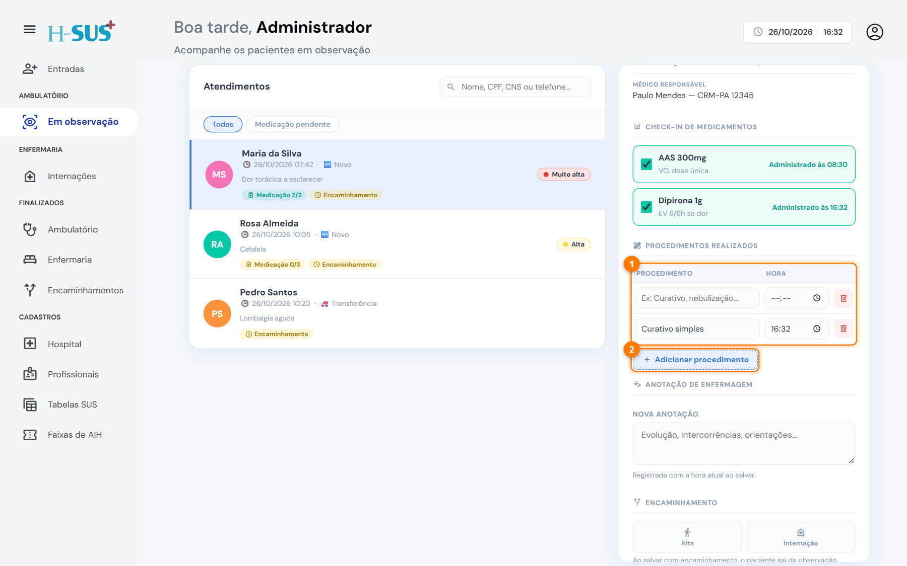
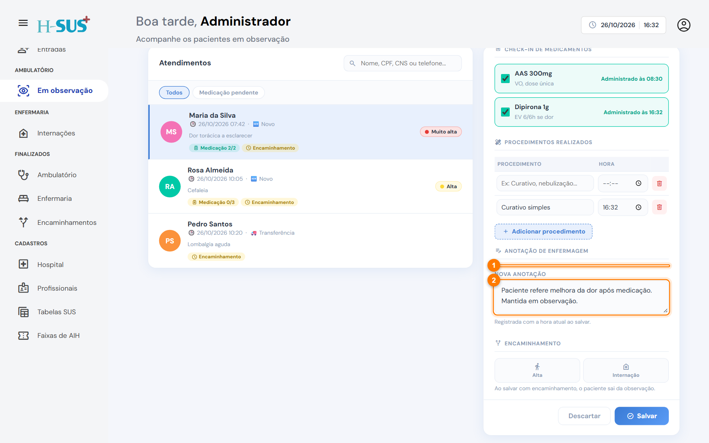
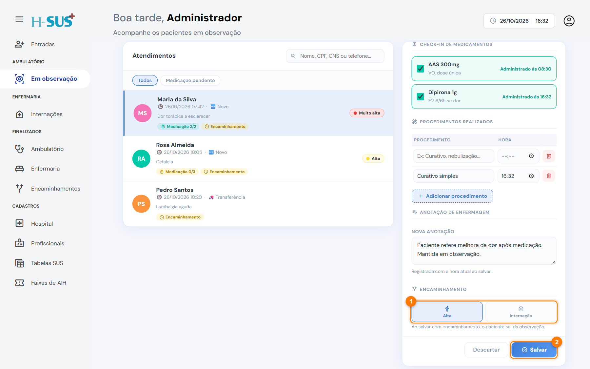

# Em observação

Em **Ambulatório › Em observação** ficam os pacientes encaminhados para o ambulatório na consulta, ou transferidos com esse destino. Aqui a equipe registra a medicação administrada, os procedimentos e as anotações, e decide se o paciente recebe **alta** ou vai para **internação**.

<figure><figcaption>
Tela Em observação
</figcaption></figure>

1. **Busca e filtros:** procure por nome, CPF, CNS ou telefone.
2. **Lista de pacientes:** cada paciente mostra a classificação de risco e etiquetas com o andamento, como "Medicação 1/2" (um de dois medicamentos administrados) e "Encaminhamento" (ainda sem destino).
3. **Resumo do paciente:** dados pessoais, alergias, sinais vitais da triagem, queixa, diagnóstico inicial, plano de cuidado e médico responsável.

O filtro **Medicação pendente** (1) mostra só quem ainda tem medicamento sem check-in (2):

<figure><figcaption>
Filtro Medicação pendente
</figcaption></figure>

## Registrar o acompanhamento



### Faça o check-in dos medicamentos

Clique no paciente na lista. Em **Check-in de medicamentos** (1) estão os medicamentos prescritos na consulta. Marque a caixa ao administrar: o horário e o seu nome são gravados **na hora**, sem precisar salvar. Se marcou por engano, desmarque; o desfazer também fica registrado.

<figure><figcaption>
Check-in de medicamentos
</figcaption></figure>




### Registre os procedimentos

Em **Procedimentos realizados** (1), clique em **Adicionar procedimento** (2), descreva o procedimento e confira a hora, que já vem com o horário atual.

<figure><figcaption>
Procedimentos realizados
</figcaption></figure>




### Escreva a anotação de enfermagem

As anotações anteriores ficam listadas (1). Escreva a nova anotação (2): evolução, intercorrências e orientações. Ela recebe a hora em que você salvar.

<figure><figcaption>
Anotação de enfermagem
</figcaption></figure>




### Encaminhe e salve

Quando o paciente for sair da observação, escolha **Alta** ou **Internação** (1) e clique em **Salvar** (2). **Descartar** desfaz o que não foi salvo.

<figure><figcaption>
Encaminhamento da observação
</figcaption></figure>





Ao salvar com um encaminhamento, o paciente sai da observação:

* **Alta:** o atendimento vai para [Finalizados › Ambulatório](../finalizados/ambulatorio.md).
* **Internação:** o paciente aparece em [Internações](../enfermaria/internacoes.md), aguardando admissão. O atendimento também fica em Finalizados › Ambulatório como "Internação".



Você pode salvar quantas vezes quiser sem encaminhamento, por exemplo para registrar procedimentos e anotações ao longo do plantão.

