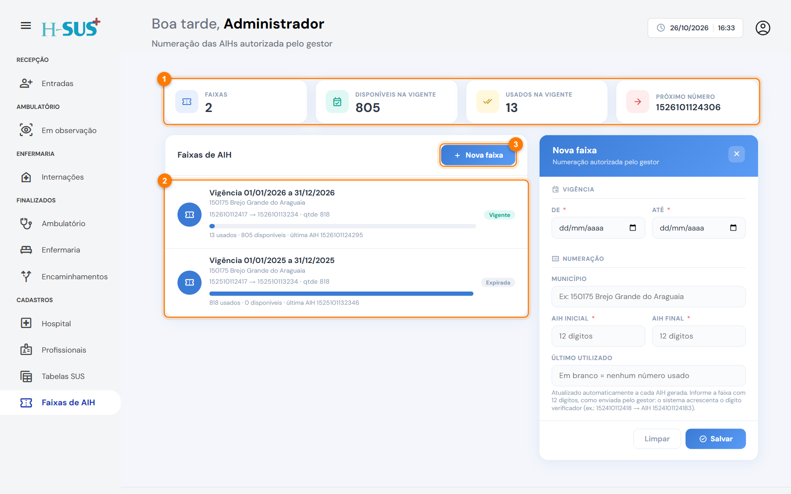
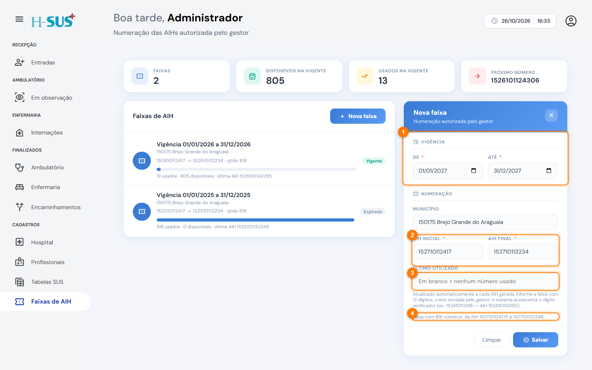

# Faixas de AIH

Em **Cadastros › Faixas de AIH** você registra as faixas de números de AIH que o gestor (secretaria de saúde) autorizou para o hospital. O botão **Gerar AIHs**, em [Finalizados › Enfermaria](../finalizados/aih-e-producao.md), usa esses números.

<figure><figcaption>
Cadastros › Faixas de AIH
</figcaption></figure>

1. **Indicadores:** quantidade de faixas, números disponíveis e usados na faixa vigente e o **próximo número** que será usado.
2. **Faixas cadastradas:** vigência, município, números inicial e final, quantidade, barra de uso e situação (**Vigente** ou **Expirada**).
3. **Nova faixa:** abre o formulário.

## Cadastrar uma faixa



### Preencha a vigência e a numeração

Clique em **Nova faixa**.

<figure><figcaption>
Nova faixa de AIH
</figcaption></figure>

1. **Vigência:** as datas de início e de fim.
2. **AIH inicial** e **AIH final** com **12 dígitos**, exatamente como o gestor enviou. O sistema acrescenta o dígito verificador ao gerar cada AIH (por exemplo, a faixa 152410112418 gera a AIH 1524101124183). Preencha também o **município** (código e nome).
3. **Último utilizado:** deixe em branco numa faixa nova. Se parte dela já foi usada em outro sistema, informe o último número usado.
4. **Resumo:** confira a quantidade e o intervalo de AIHs da faixa.



### Salve

Clique em **Salvar**.




Duas faixas não podem ter números em comum. Só é possível **excluir** uma faixa que nunca foi usada.


## Números cancelados

Quando uma AIH é cancelada, o número aparece numa lista acima das faixas, aguardando reaproveitamento. Ele passa a ser o **próximo número** e é usado antes da sequência da faixa.
