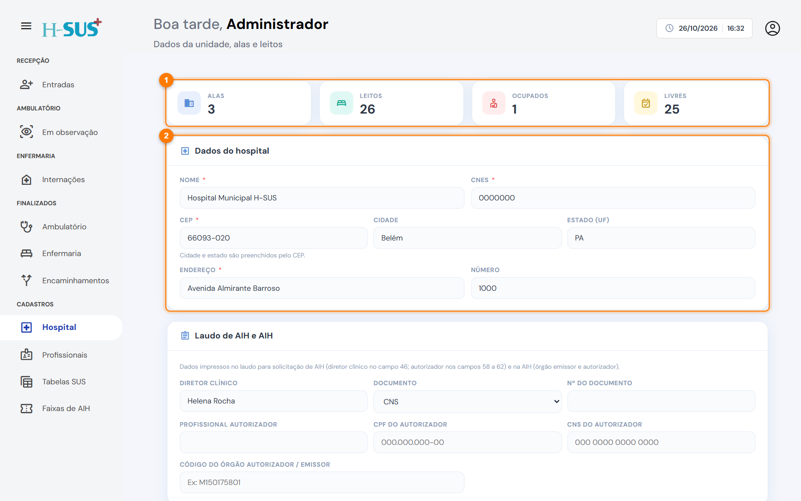
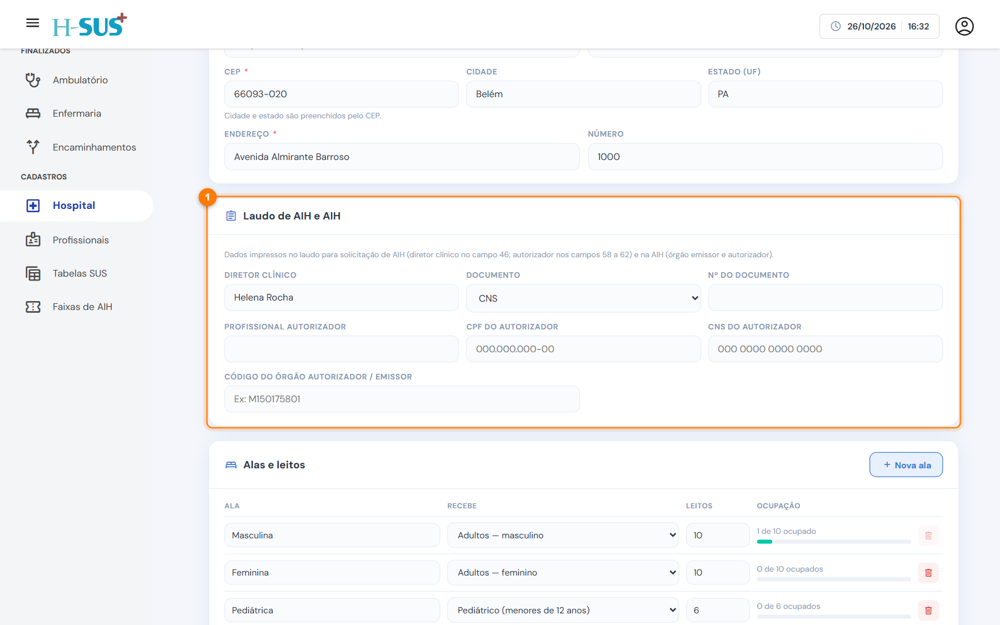
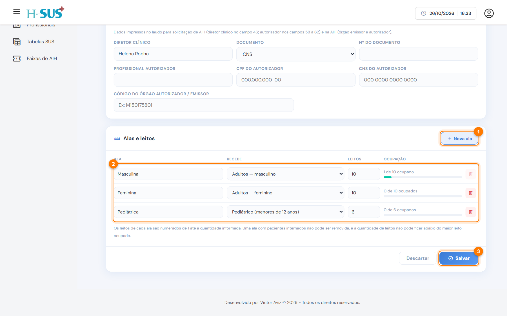

# Hospital

Em **Cadastros › Hospital** ficam os dados da unidade que aparecem nos documentos e a configuração das **alas e leitos** da enfermaria. Somente o administrador acessa esta tela.

## Dados do hospital

<figure><figcaption>
Resumo dos leitos e dados do hospital
</figcaption></figure>

1. **Resumo dos leitos:** quantidade de alas e de leitos e quantos estão ocupados e livres agora.
2. **Dados do hospital:** nome, CNES e endereço. Digite o **CEP** e, com internet, cidade e estado são preenchidos sozinhos.


Confira o nome e o **CNES** antes de emitir documentos: eles saem no cabeçalho do prontuário, no laudo de AIH e na AIH.


## Responsáveis pelo laudo de AIH e pela AIH

<figure><figcaption>
Laudo de AIH e AIH
</figcaption></figure>

O cartão **Laudo de AIH e AIH** (1) traz quem é impresso nos documentos:

* **Diretor clínico** e o documento dele (campo 46 do laudo).
* **Profissional autorizador**, com CPF e CNS (campos 58 a 62 do laudo).
* **Código do órgão autorizador / emissor**, impresso na AIH.

## Alas e leitos

<figure><figcaption>
Alas e leitos
</figcaption></figure>

1. **Nova ala:** acrescenta uma linha para a ala nova.
2. **Alas:** cada ala tem um nome, o **público que recebe** (adultos masculino, adultos feminino, pediátrico etc.) e a **quantidade de leitos**. A barra mostra a ocupação.
3. **Salvar:** grava as mudanças. **Descartar** desfaz.

* Os leitos são numerados de 1 até a quantidade informada.
* Na admissão, o paciente só pode ir para alas compatíveis com o sexo e a idade dele.


Uma ala com pacientes internados **não pode ser removida**. A quantidade de leitos também não pode ficar abaixo do número do maior leito ocupado.

