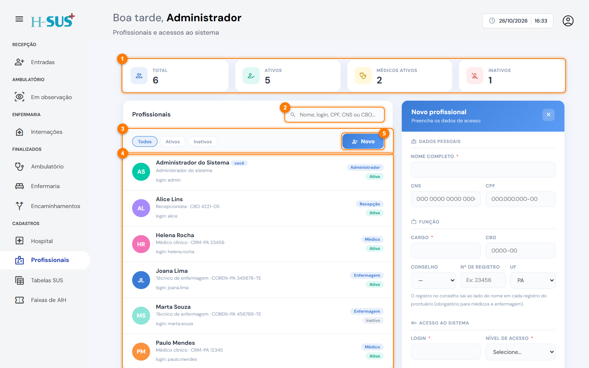
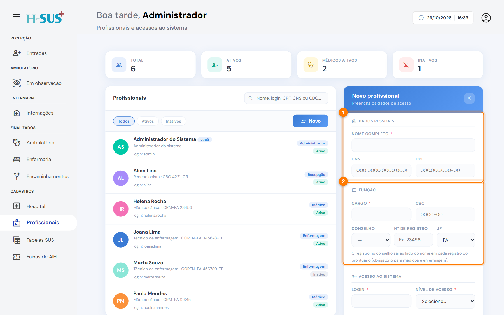
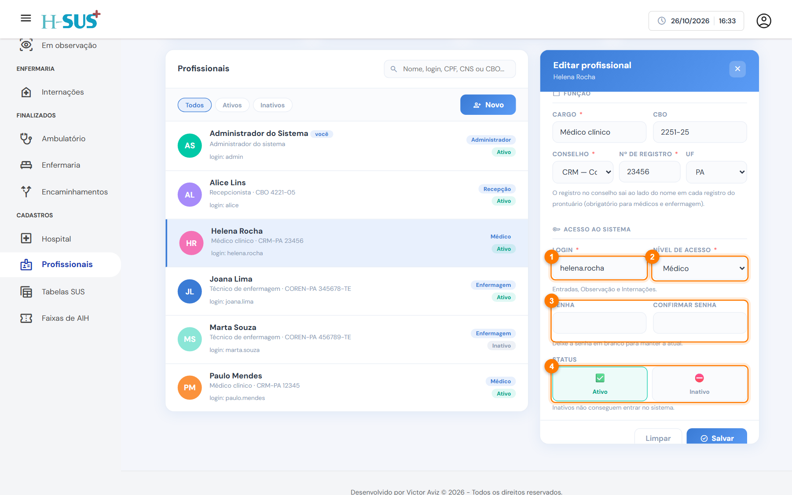

# Profissionais

Em **Cadastros › Profissionais** o administrador cadastra quem usa o sistema: os dados de cada profissional, a função, o registro no conselho e o acesso (login, senha e nível).

<figure><figcaption>
Cadastros › Profissionais
</figcaption></figure>

1. **Indicadores:** total, ativos, médicos ativos e inativos.
2. **Busca:** por nome, login, CPF, CNS ou CBO.
3. **Filtros:** **Todos**, **Ativos** e **Inativos**.
4. **Lista:** cada profissional com o cargo, o CBO ou o conselho, o login, o nível de acesso e a situação.
5. **Novo:** abre o formulário para um profissional novo.

## Cadastrar um profissional



### Preencha os dados pessoais e a função

Clique em **Novo**.

<figure><figcaption>
Dados pessoais e função
</figcaption></figure>

1. **Dados pessoais:** nome completo e, se tiver, CNS e CPF. O CNS e o CBO do médico saem no laudo de AIH e na produção.
2. **Função:** escolha o **cargo** (para os mais comuns, o **CBO** é preenchido sozinho). Para médicos e enfermagem, preencha o **conselho** (CRM, COREN…), o **número de registro** e a **UF**: são obrigatórios porque saem ao lado do nome em cada registro do prontuário.



### Defina o acesso

<figure><figcaption>
Acesso ao sistema
</figcaption></figure>

1. **Login:** o nome de usuário para entrar.
2. **Nível de acesso:** Administrador, Médico, Enfermagem ou Recepção. Veja o que cada um acessa em [Perfis de acesso](../primeiros-passos/perfis-de-acesso.md).
3. **Senha** (mínimo de 6 caracteres), repetida em **Confirmar senha**.
4. **Status:** **Ativo** para liberar o acesso.



### Salve

Clique em **Salvar**. O profissional já pode entrar no sistema.



## Trocar a senha ou desativar

* Para definir uma senha nova, abra o profissional, digite a nova senha nos dois campos e salve. Com os campos de senha em branco, a senha atual é mantida.
* A senha é guardada de forma criptografada: nem o administrador consegue vê-la.
* Quem deixa o hospital deve ser marcado como **Inativo**. Inativos não conseguem entrar no sistema, mas os registros feitos por eles continuam no prontuário com o nome deles.


O sistema sempre exige **pelo menos um administrador ativo**. Não é possível desativar ou rebaixar o último.

