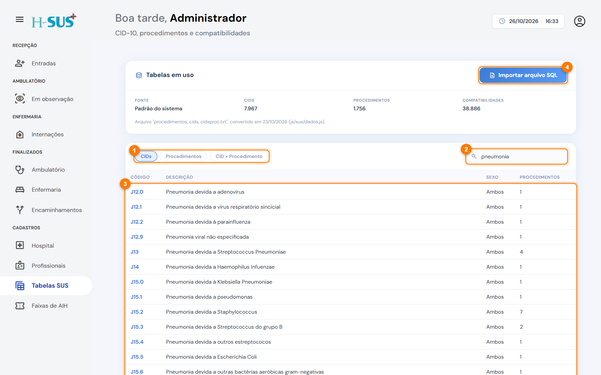
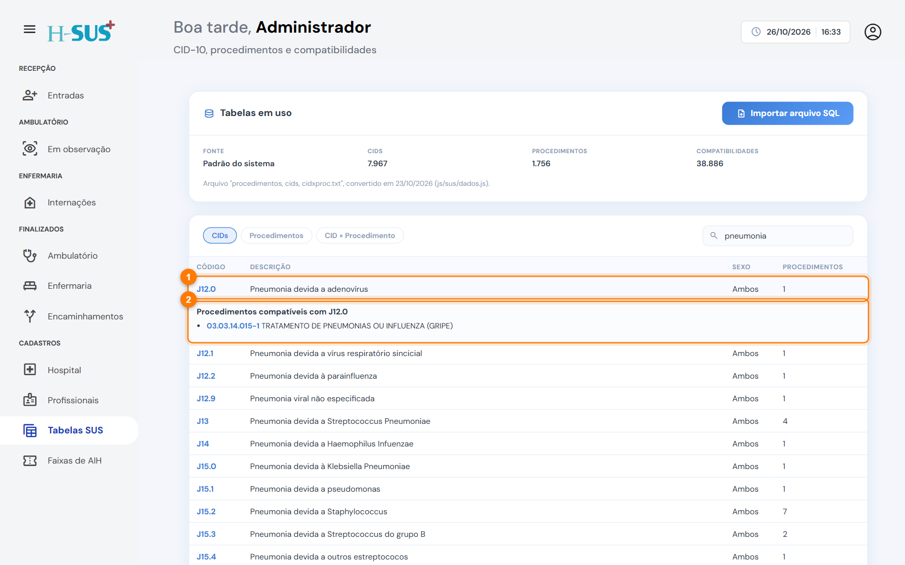
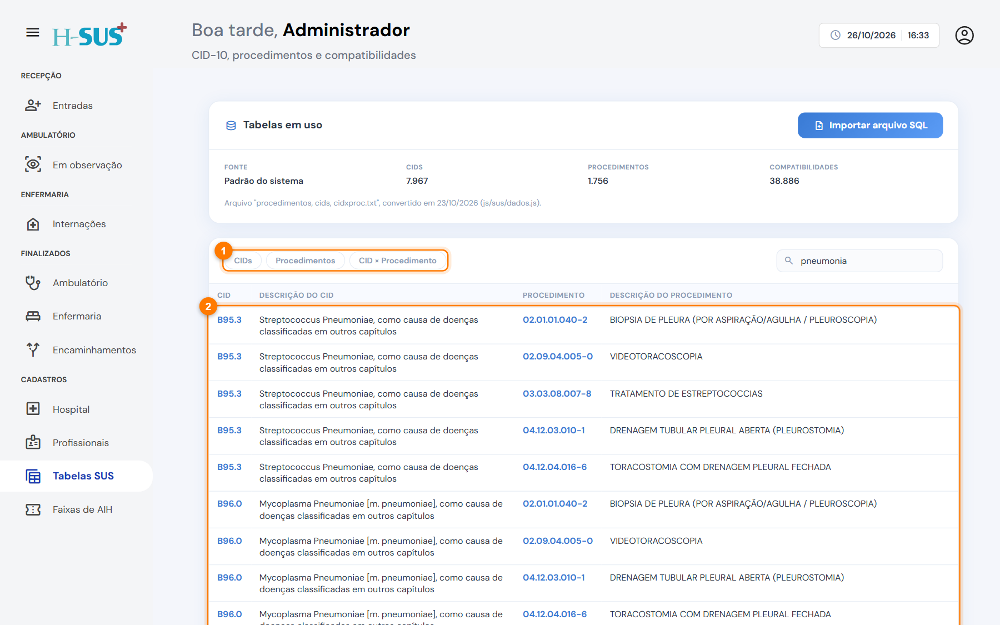

# Tabelas SUS

Em **Cadastros › Tabelas SUS** ficam as tabelas usadas na saída da internação: **CID-10**, **procedimentos SUS** e as **compatibilidades** entre eles. São elas que fazem o sistema mostrar só os procedimentos compatíveis com o CID, o sexo e a idade do paciente.

<figure><figcaption>
Cadastros › Tabelas SUS, buscando &quot;pneumonia&quot;
</figcaption></figure>

No alto, **Tabelas em uso** mostra a fonte das tabelas (padrão do sistema ou arquivo importado) e a quantidade de CIDs, procedimentos e compatibilidades.

1. **Abas:** **CIDs**, **Procedimentos** e **CID × Procedimento**.
2. **Busca:** digite o código ou parte da descrição.
3. **Resultados:** a lista do que foi encontrado.
4. **Importar arquivo SQL:** atualiza as tabelas.

## Ver o que é compatível

Clique em uma linha (1) para ver os itens compatíveis (2). No CID, aparecem os procedimentos permitidos, com sexo e idade.

<figure><figcaption>
Procedimentos compatíveis com um CID
</figcaption></figure>

Na aba **Procedimentos** (1), a lista (2) mostra cada procedimento com os CIDs compatíveis.

<figure><figcaption>
Aba Procedimentos
</figcaption></figure>

## Atualizar as tabelas



### Importe o arquivo

Clique em **Importar arquivo SQL** e escolha o arquivo exportado do banco com as tabelas `procedimentos`, `cids` e `procedxcid`.



### Confira as novas quantidades

Aguarde a conversão. **Tabelas em uso** passa a mostrar o arquivo importado e as novas quantidades.



Para voltar às tabelas que vêm com o sistema, clique em **Restaurar padrão**.


Atualize as tabelas sempre que o SUS publicar uma nova competência da tabela de procedimentos.

