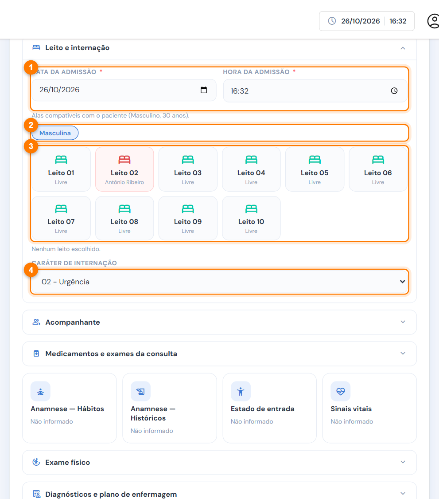
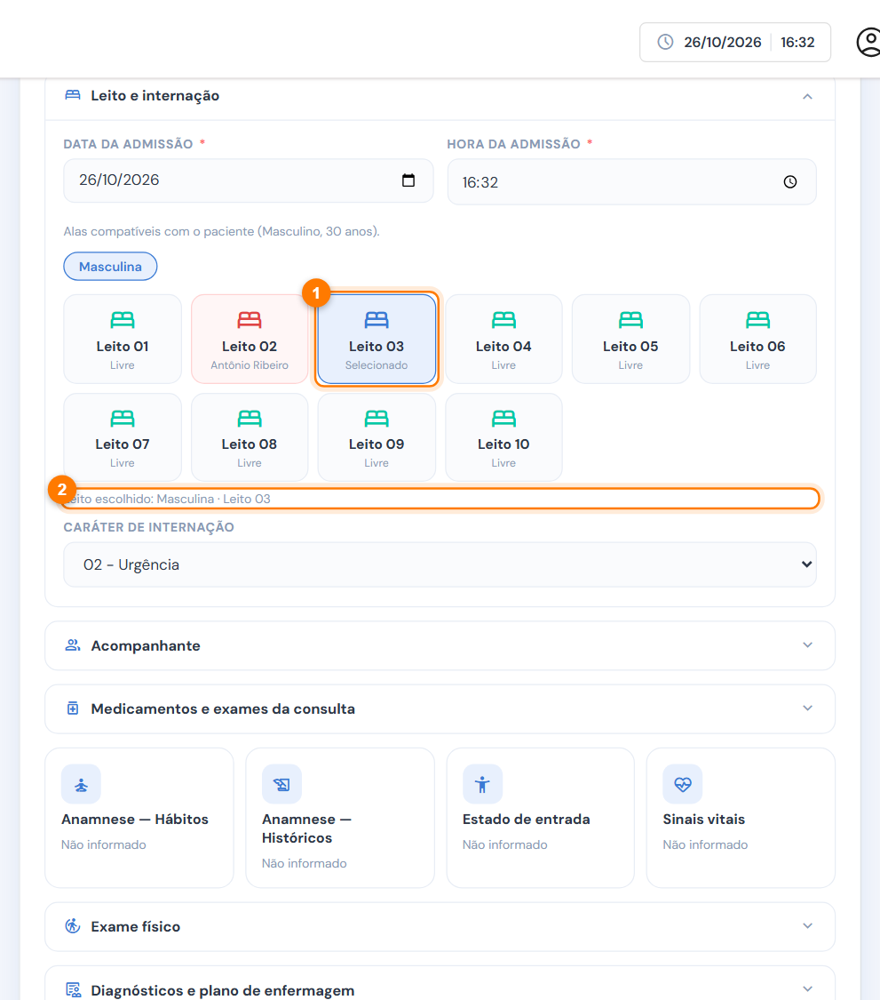
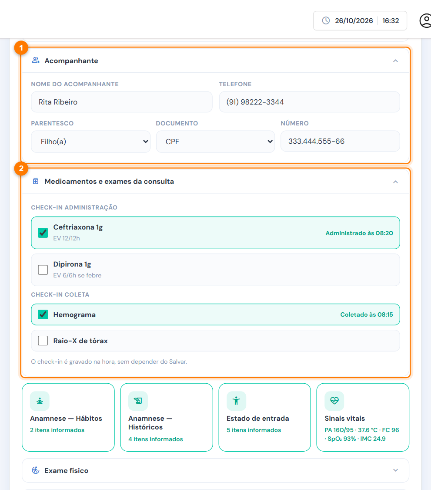
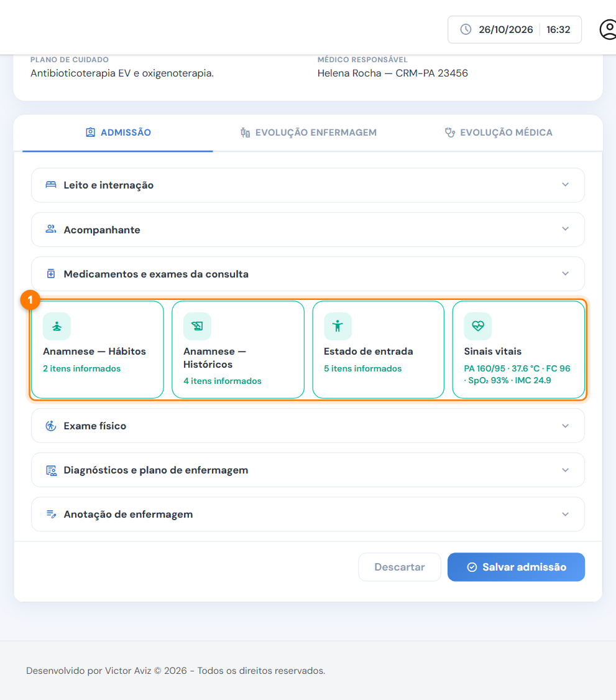
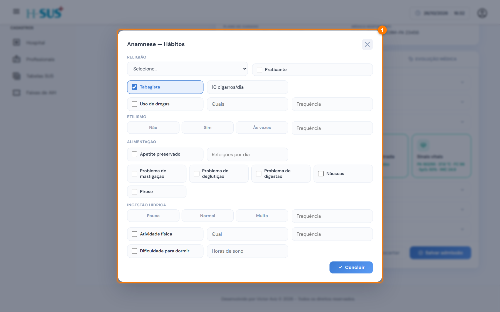
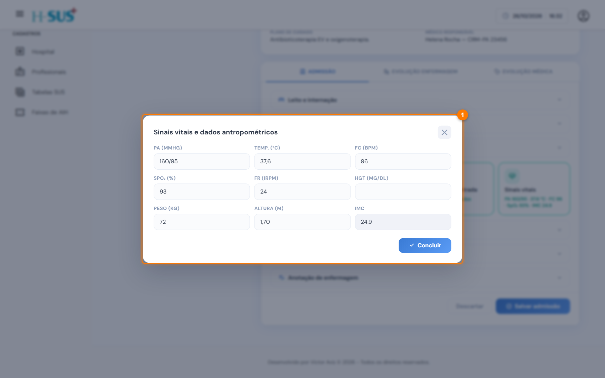
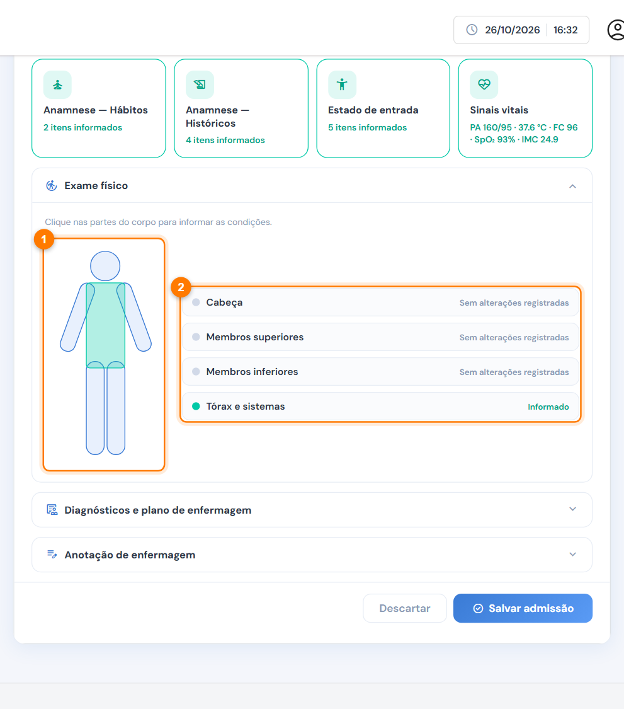
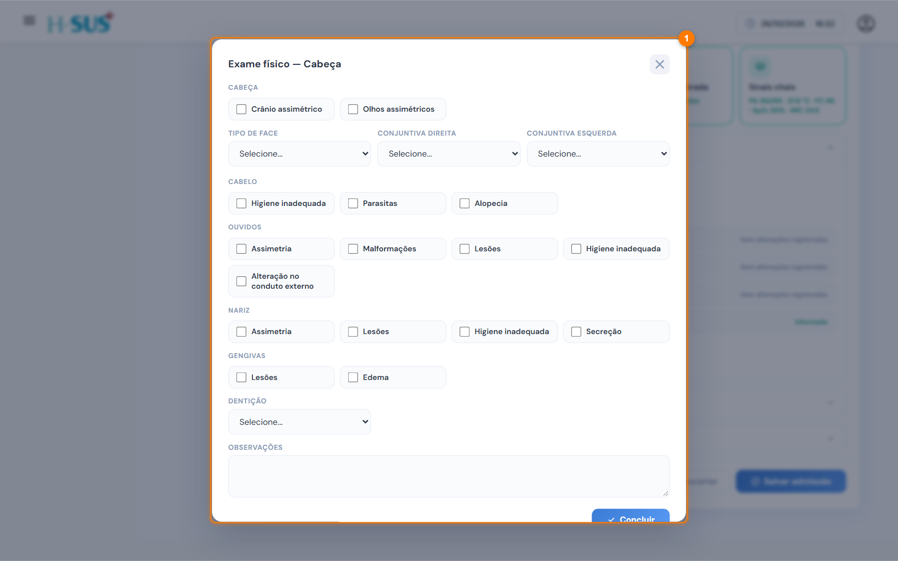
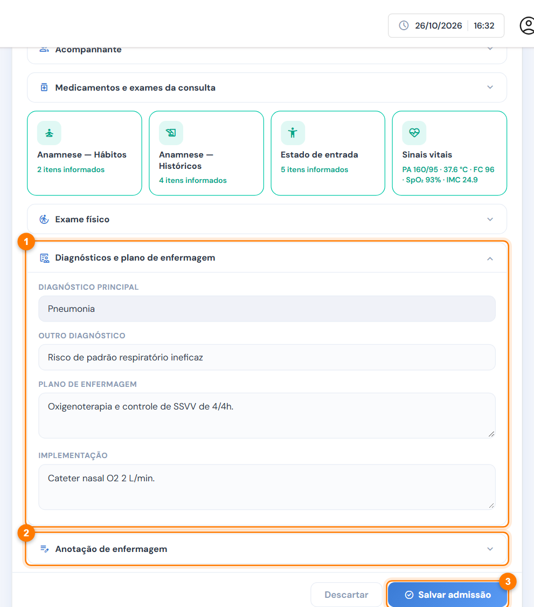

# Admissão

A admissão coloca o paciente no leito e registra a avaliação inicial de enfermagem. Ela é o primeiro passo da internação: as evoluções só liberam depois que a admissão for salva.



### Escolha o leito

Selecione o paciente **Aguardando admissão** na lista e abra a aba **Admissão**.

<figure><figcaption>
Leito e internação
</figcaption></figure>

1. Confira a **data e a hora da admissão**. As duas são obrigatórias.
2. Escolha a **ala**. O sistema mostra só as alas compatíveis com o sexo e a idade do paciente (por exemplo, a pediátrica para menores de 12 anos).
3. Clique em um **leito livre**. Os ocupados aparecem em vermelho, com o nome de quem está nele.
4. Escolha o **caráter da internação**: eletiva, urgência, acidente no local de trabalho, acidente no trajeto, outros acidentes de trânsito ou outras lesões.



### Confira o leito escolhido

O leito fica destacado (1) e a mensagem abaixo confirma a ala e o número (2).

<figure><figcaption>
Leito selecionado
</figcaption></figure>




### Registre o acompanhante e os check-ins da consulta

Clique no título de cada seção para abri-la.

<figure><figcaption>
Acompanhante e medicamentos da consulta
</figcaption></figure>

1. **Acompanhante:** nome, telefone, parentesco e documento.
2. **Medicamentos e exames da consulta:** check-in da administração e da coleta. Como no ambulatório, a marcação é gravada na hora.



### Preencha a anamnese e os sinais vitais

Os cartões (1) abrem formulários próprios. Clique em **Concluir** para voltar; o cartão passa a mostrar quantos itens foram informados.

<figure><figcaption>
Cartões da admissão
</figcaption></figure>

* **Anamnese — Hábitos:** religião, tabagismo, drogas, etilismo, alimentação, ingestão hídrica, atividade física e sono.
* **Anamnese — Históricos:** doenças, internações, cirurgias e medicamentos de uso contínuo do paciente e da família.
* **Estado de entrada:** modo de entrada, consciência, pupilas, autocuidado e higiene.
* **Sinais vitais:** PA, temperatura, FC, SpO₂, FR, glicemia, peso e altura. O IMC é calculado sozinho.

<figure><figcaption>
Cartão Anamnese — Hábitos aberto
</figcaption></figure>

<figure><figcaption>
Cartão Sinais vitais aberto
</figcaption></figure>




### Faça o exame físico

Abra **Exame físico** e clique na região do corpo (1): cabeça, tórax e sistemas, membros superiores ou inferiores. Marque as alterações encontradas. A legenda (2) mostra as regiões já avaliadas.

<figure><figcaption>
Mapa do corpo para o exame físico
</figcaption></figure>

<figure><figcaption>
Exame físico da região da cabeça
</figcaption></figure>




### Registre o plano e salve

<figure><figcaption>
Diagnósticos, plano e anotação
</figcaption></figure>

1. **Diagnósticos e plano de enfermagem:** o diagnóstico principal vem da consulta. Registre outro diagnóstico, se houver, o plano e a implementação.
2. **Anotação de enfermagem:** o registro da admissão.
3. Clique em **Salvar admissão**. O leito fica ocupado e as abas de evolução são liberadas.




Os dados dos cartões só são gravados ao clicar em **Salvar admissão**. **Concluir**, dentro do cartão, apenas fecha o formulário.



Para corrigir a admissão, altere os campos e salve de novo. Cada alteração fica registrada com seu nome e o horário.

