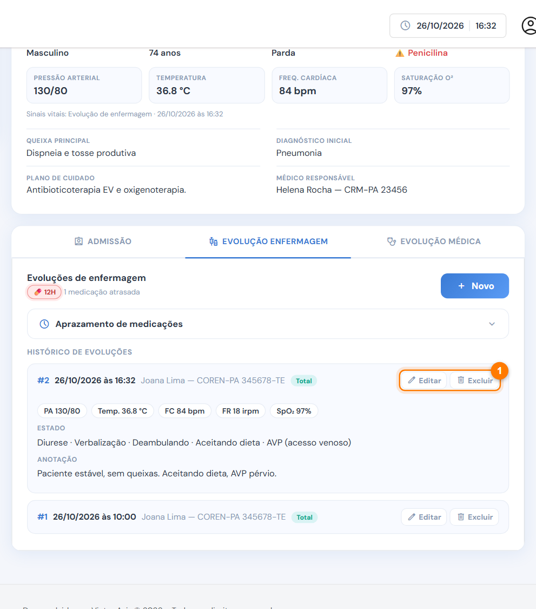
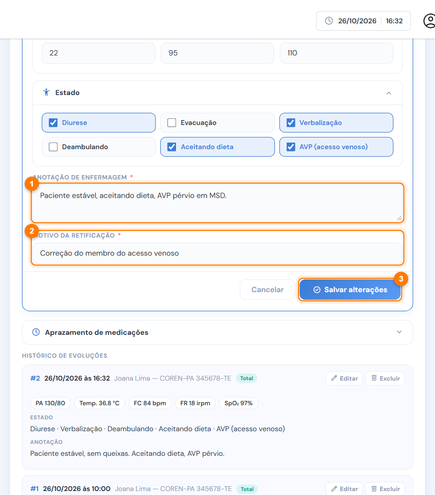
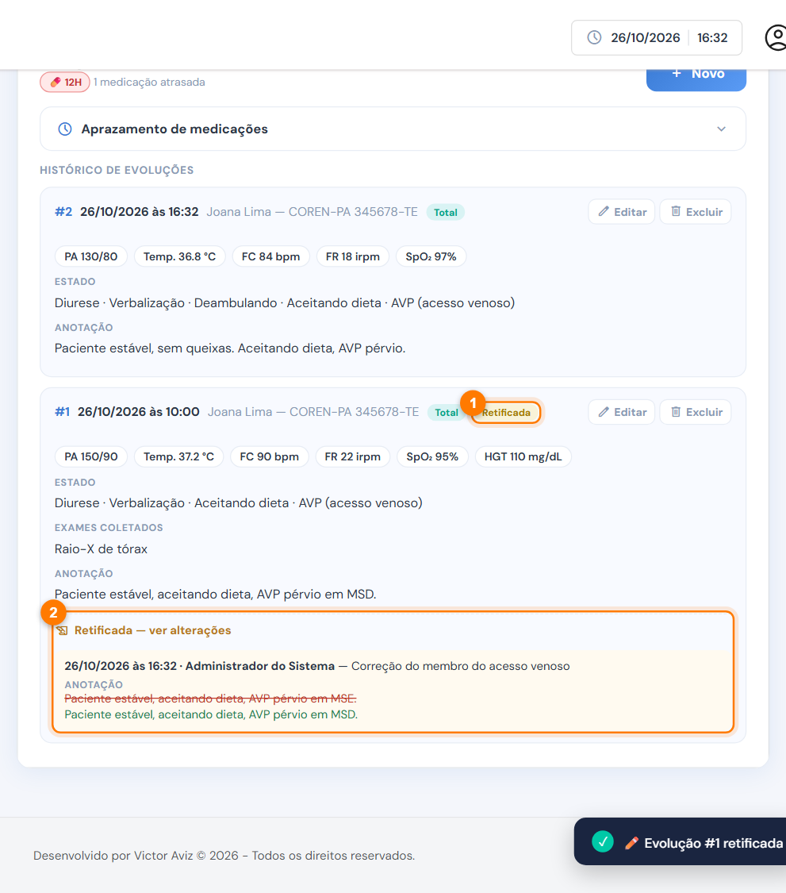
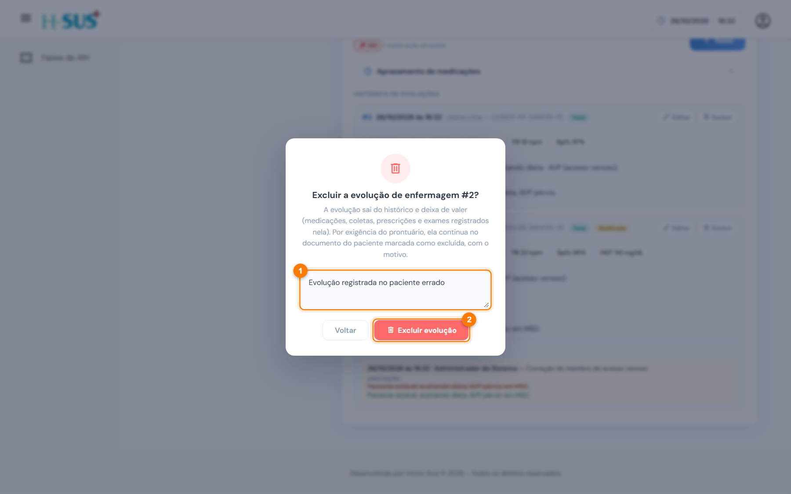
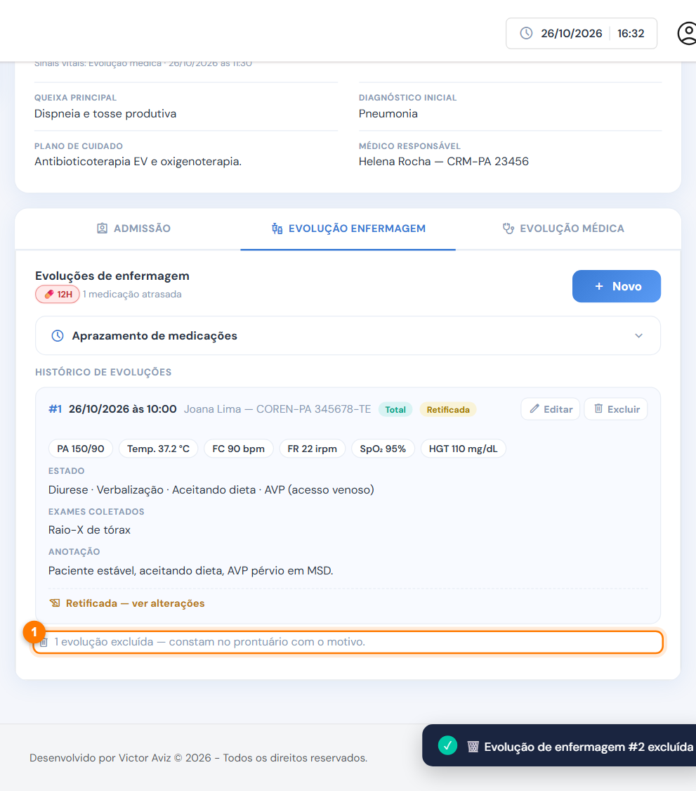

# Editar ou excluir uma evolução

As evoluções fazem parte do prontuário do paciente. Por isso, o sistema **nunca apaga** um registro: a edição guarda a versão anterior e a exclusão marca a evolução como excluída, com o motivo. Isso segue as regras de prontuário do CFM e do COFEN.


Só **quem lançou a evolução** e o **administrador** veem os botões Editar e Excluir (1).


<figure><figcaption>
Botões Editar e Excluir no histórico
</figcaption></figure>

## Editar (retificar)



### Abra a evolução para edição

No histórico, clique em **Editar**. O formulário abre preenchido, com o título "Editar evolução #número".



### Corrija e informe o motivo

Corrija o que for preciso (1) e informe o **motivo da retificação** (2), que é obrigatório. Clique em **Salvar alterações** (3).

<figure><figcaption>
Correção com o motivo da retificação
</figcaption></figure>




### Confira a retificação

A evolução ganha a etiqueta **Retificada** (1). Em **ver alterações** (2) aparecem quem corrigiu, quando e o motivo, com o texto anterior riscado em vermelho e o novo em verde.

<figure><figcaption>
Evolução retificada
</figcaption></figure>




A evolução continua em nome de quem a lançou. Na evolução de enfermagem, as doses registradas naquela evolução aparecem marcadas e podem ser desmarcadas. Na evolução médica, a mudança na prescrição atualiza o aprazamento.

## Excluir



### Informe o motivo

No histórico, clique em **Excluir**. Escreva o **motivo da exclusão** (1), que é obrigatório, e clique em **Excluir evolução** (2).

<figure><figcaption>
Confirmação da exclusão com o motivo
</figcaption></figure>




### Confira o aviso

A evolução sai do histórico e, no fim da lista, aparece o aviso de evolução excluída (1).

<figure><figcaption>
Aviso de evolução excluída
</figcaption></figure>




O que acontece com uma evolução excluída:

* Ela deixa de valer: as doses voltam a ficar pendentes, e as prescrições e os exames dela saem das listas em uso.
* No **prontuário**, ela continua visível, marcada como **EXCLUÍDA**, com quem excluiu, quando e o motivo.
* A numeração não muda. Se a evolução nº 2 for excluída, a próxima continua sendo a nº 3.
