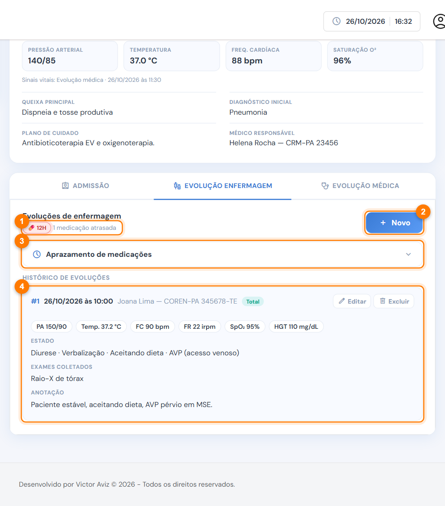
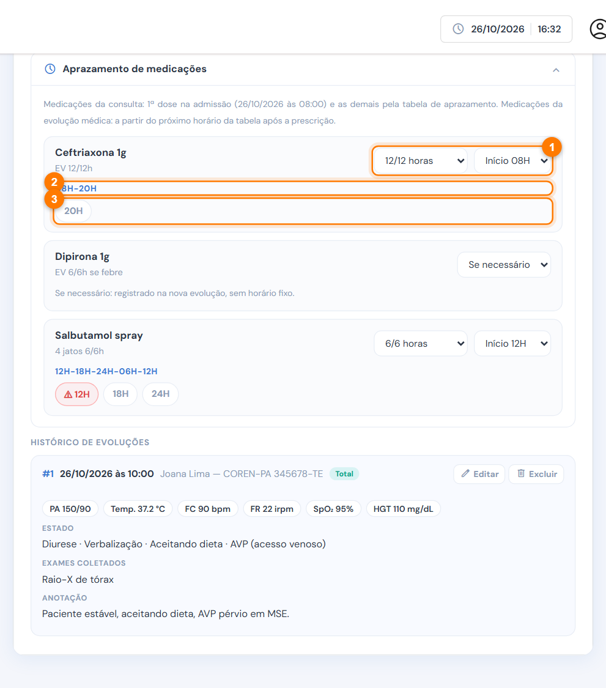
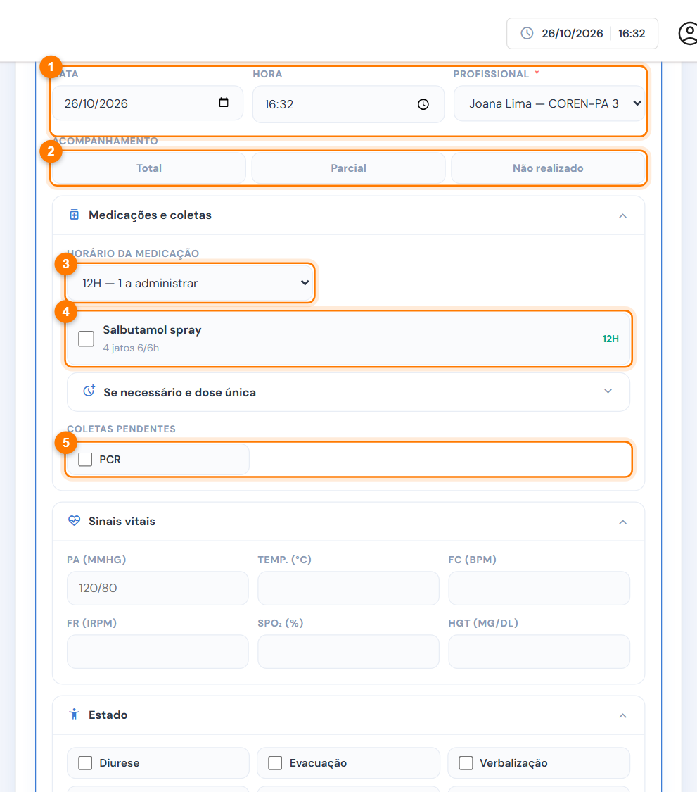
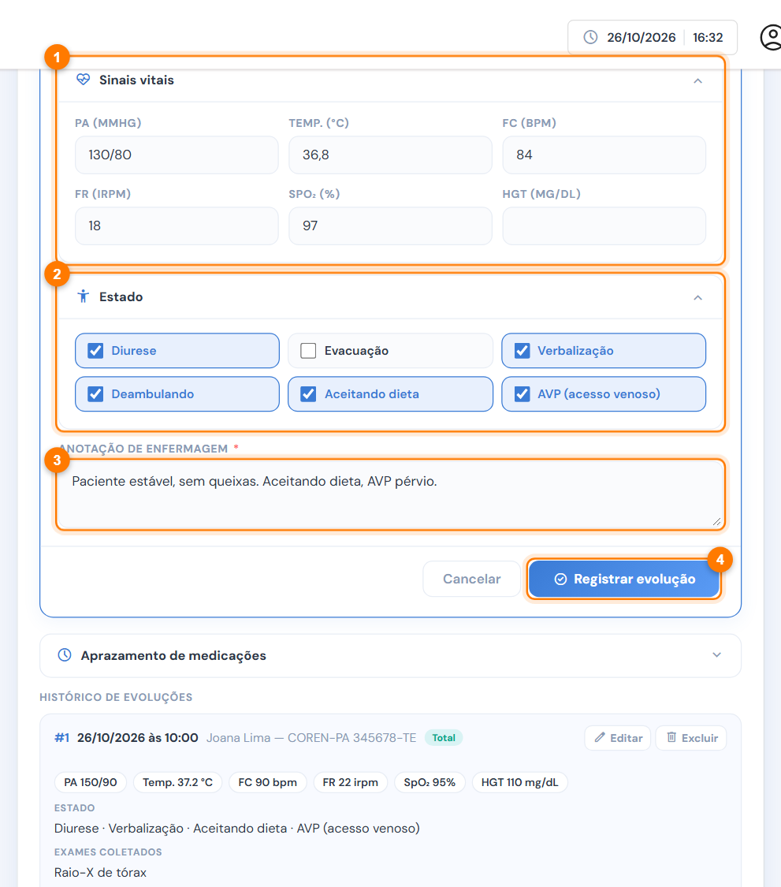
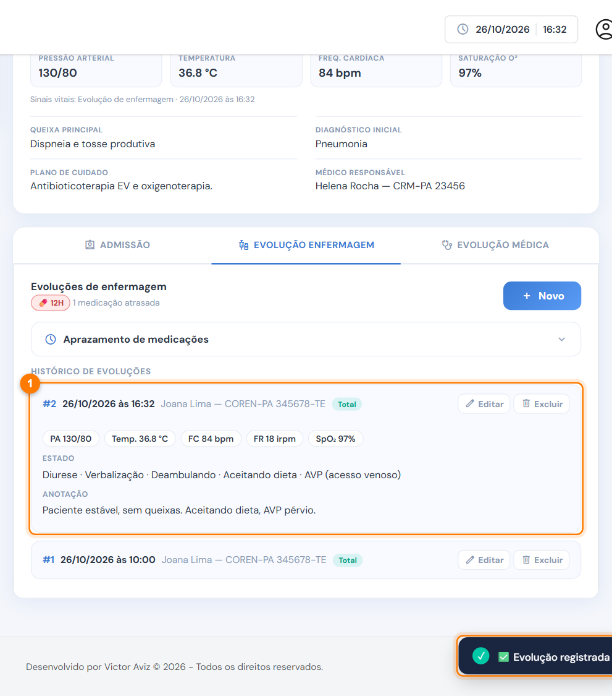

# Evolução de enfermagem

A aba **Evolução de enfermagem** reúne o aprazamento das medicações e as evoluções de cada plantão: doses administradas, coletas de exames, sinais vitais, estado do paciente e anotação.

<figure><figcaption>
Aba Evolução de enfermagem
</figcaption></figure>

1. **Aviso de medicação:** doses atrasadas ou a próxima medicação do dia.
2. **Novo:** abre o formulário de uma nova evolução.
3. **Aprazamento de medicações:** os horários de cada medicamento prescrito.
4. **Histórico de evoluções:** as evoluções registradas, da mais recente para a mais antiga.

## Aprazamento

Abra **Aprazamento de medicações** para ver e ajustar os horários de cada medicamento prescrito, na consulta ou nas evoluções médicas.

<figure><figcaption>
Aprazamento de medicações
</figcaption></figure>

1. **Intervalo e início:** 6/6, 8/8, 12/12 ou 24/24 horas, **Dose única** ou **Se necessário**. O sistema lê o intervalo da posologia ("EV 12/12h", por exemplo) e sugere o início pela tabela do hospital. Mudou? A mudança vale para o paciente e é gravada na hora.
2. **Sequência de horários** do dia.
3. **Situação de cada horário hoje:**

| Etiqueta | Significado |
| --- | --- |
| ✓ 12H #2 · 12:05 | Dose registrada na evolução nº 2, às 12:05 |
| ⚠ 06H (vermelha) | Dose atrasada, sem registro |
| 18H | Dose pendente, ainda no horário |


**Primeira dose:** a medicação da consulta tem a 1ª dose na admissão e as próximas pela tabela. A medicação de evolução médica começa no próximo horário da tabela depois da prescrição.


## Registrar uma evolução



### Abra o formulário e registre as medicações

Clique em **Novo**.

<figure><figcaption>
Nova evolução: medicações e coletas
</figcaption></figure>

1. Confira a **data**, a **hora** e o **profissional**. O profissional vem com o usuário conectado, se for da enfermagem.
2. Marque o **acompanhamento**: total, parcial ou não realizado.
3. Escolha o **horário da medicação**. O sistema já sugere o horário pendente mais próximo.
4. Marque cada medicamento administrado naquele horário. Em **Se necessário e dose única**, marque o que foi dado fora dos horários fixos.
5. Em **Coletas pendentes**, marque os exames coletados.



### Registre sinais vitais, estado e anotação

<figure><figcaption>
Sinais vitais, estado e anotação
</figcaption></figure>

1. **Sinais vitais:** PA, temperatura, FC, FR, SpO₂ e glicemia (HGT).
2. **Estado:** diurese, evacuação, verbalização, deambulando, aceitando dieta e acesso venoso (AVP).
3. **Anotação de enfermagem.** Ela é obrigatória.
4. Clique em **Registrar evolução**.



### Confira no histórico

A nova evolução aparece no topo do histórico (1) e um aviso confirma o registro (2). As doses marcadas passam a aparecer como ✓ no aprazamento.

<figure><figcaption>
Evolução registrada
</figcaption></figure>





Registrou depois do horário? Informe a data e a hora reais do atendimento. O sistema guarda também o momento do lançamento, e o prontuário mostra os dois.


Para corrigir ou anular uma evolução, veja [Editar ou excluir uma evolução](editar-ou-excluir-evolucao.md).
