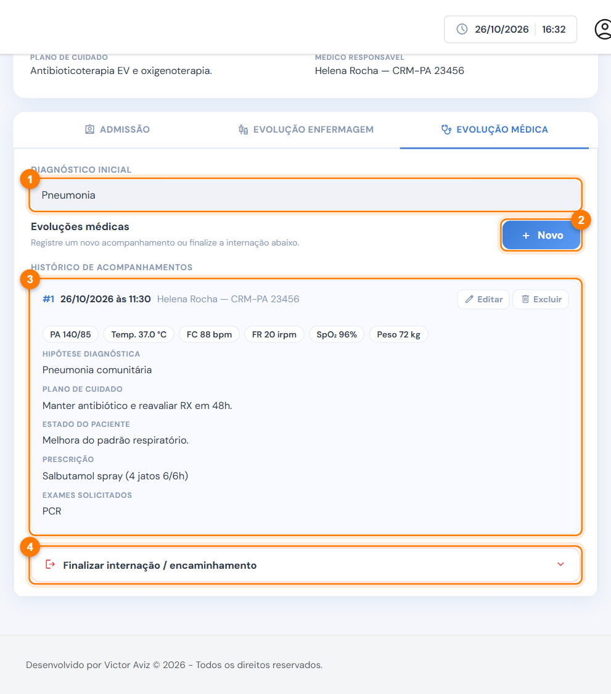
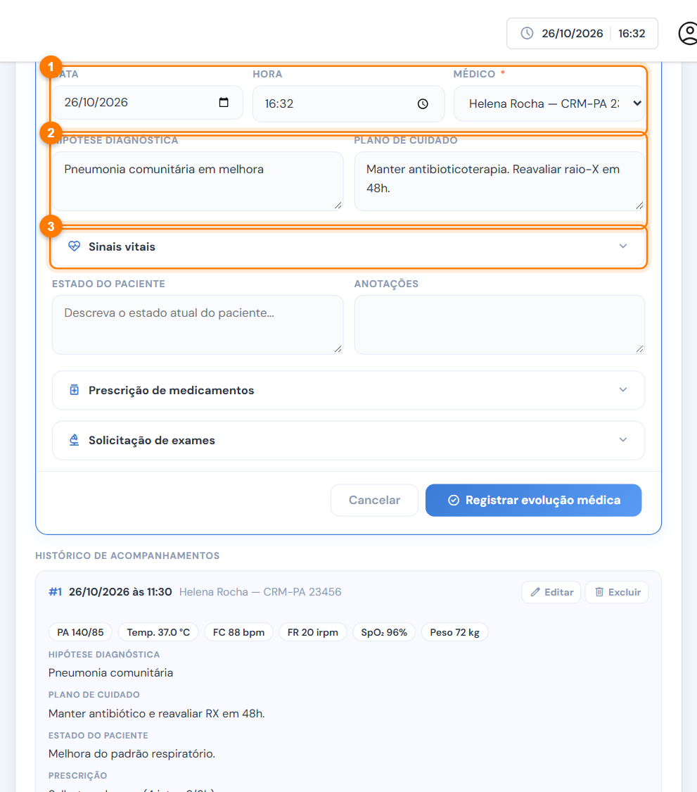
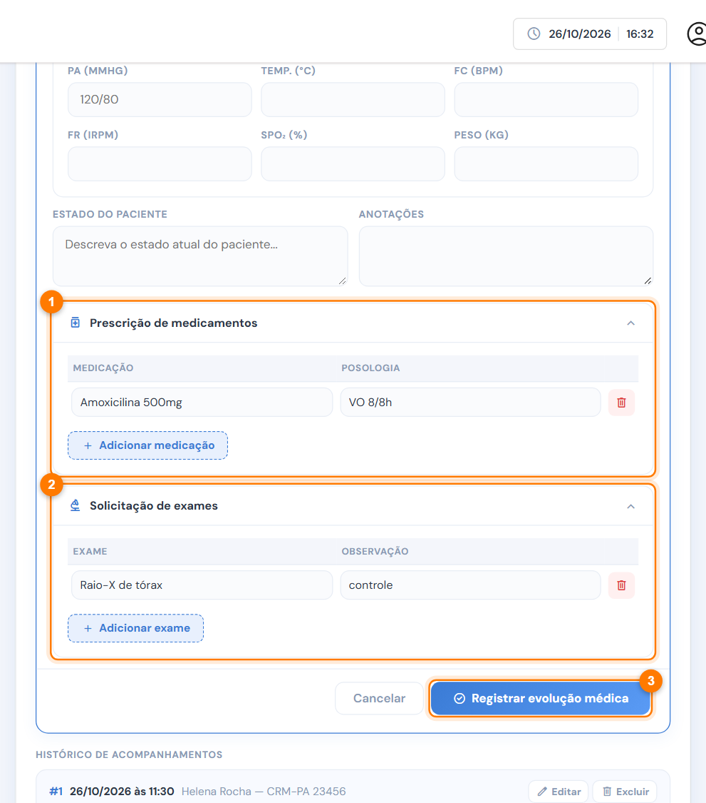

# Evolução médica

A aba **Evolução médica** registra o acompanhamento do médico durante a internação: hipótese diagnóstica, estado do paciente, plano, prescrição e exames. Também é nela que se [finaliza a internação](finalizar-internacao.md).

<figure><figcaption>
Aba Evolução médica
</figcaption></figure>

1. **Diagnóstico inicial:** o diagnóstico da consulta, para referência.
2. **Novo:** abre o formulário de um novo acompanhamento.
3. **Histórico de acompanhamentos:** as evoluções médicas e os registros de permanência.
4. **Finalizar internação / encaminhamento:** a saída do paciente.

## Registrar uma evolução



### Abra o formulário e escreva a avaliação

Clique em **Novo**.

<figure><figcaption>
Novo acompanhamento médico
</figcaption></figure>

1. Confira a **data**, a **hora** e o **médico**. O médico é obrigatório.
2. Escreva a **hipótese diagnóstica** e o **plano de cuidado**.
3. Abra **Sinais vitais** se quiser registrar PA, temperatura, FC, FR, SpO₂ e peso.

Mais abaixo, descreva o **estado do paciente** e as **anotações**.



### Prescreva e peça exames

<figure><figcaption>
Prescrição e exames da evolução médica
</figcaption></figure>

1. Em **Prescrição de medicamentos**, adicione os novos medicamentos com a posologia.
2. Em **Solicitação de exames**, adicione os exames pedidos.
3. Clique em **Registrar evolução médica**.




Preencha ao menos um campo do acompanhamento (texto, prescrição ou exame). Evolução vazia não é registrada.


## O que a prescrição e os exames geram

* Os **medicamentos prescritos** entram no [aprazamento](evolucao-de-enfermagem.md#aprazamento) da enfermagem, a partir do próximo horário da tabela.
* Os **exames solicitados** aparecem nas **coletas pendentes** da evolução de enfermagem.

Para corrigir ou anular uma evolução médica, veja [Editar ou excluir uma evolução](editar-ou-excluir-evolucao.md).
