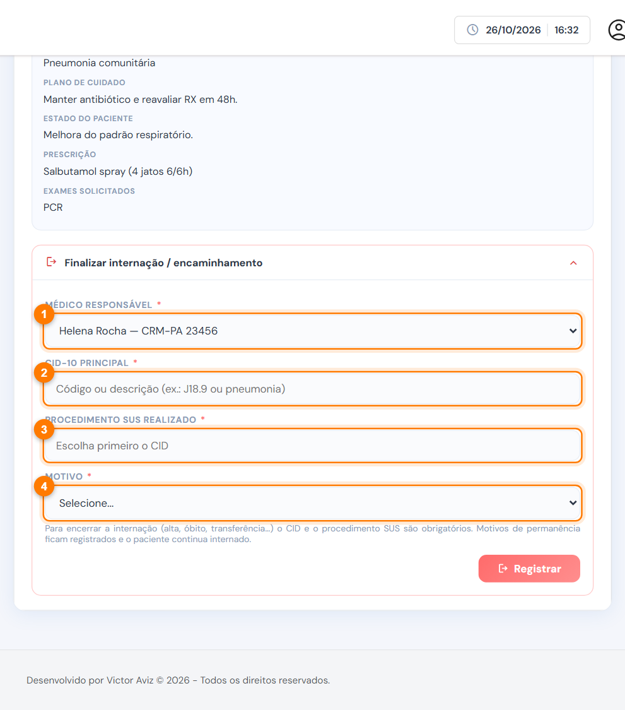
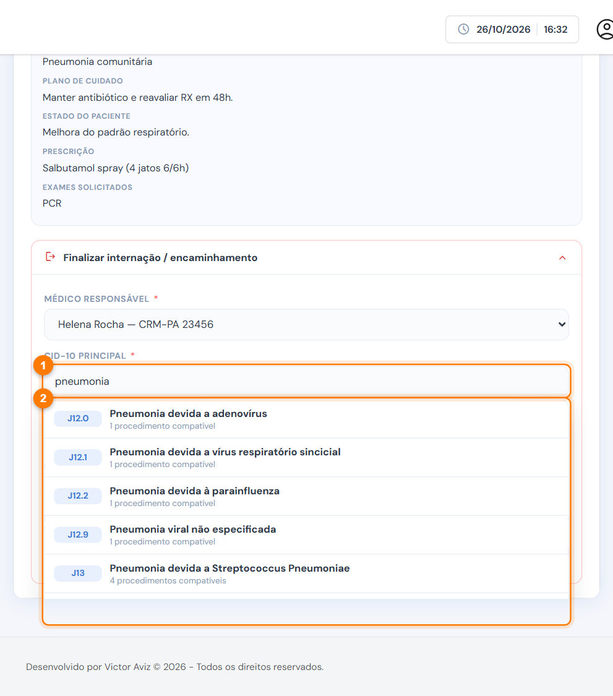
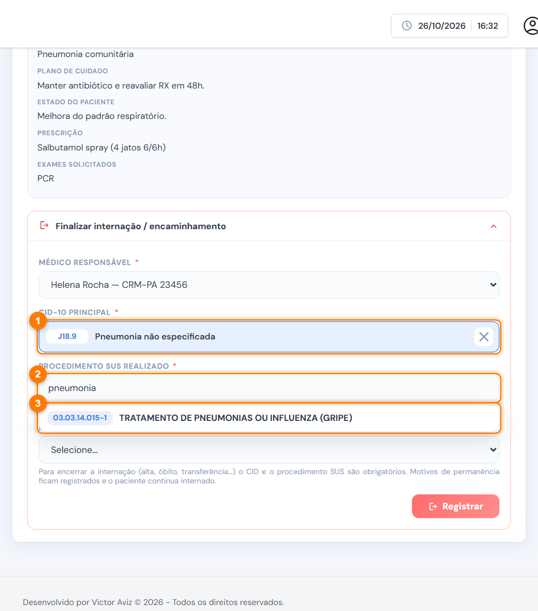
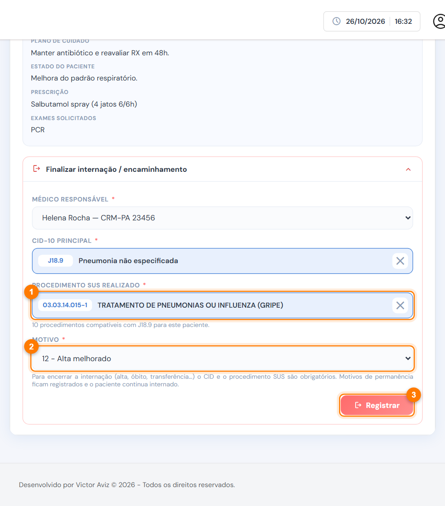

# Finalizar a internação

A saída do paciente é registrada pelo médico, na aba **Evolução médica**, no cartão **Finalizar internação / encaminhamento**. O mesmo cartão registra a **permanência**, quando o paciente continua internado por algum motivo.



### Abra o cartão

Abra **Finalizar internação / encaminhamento**, no fim da aba Evolução médica.

<figure><figcaption>
Campos da saída
</figcaption></figure>

1. **Médico responsável.**
2. **CID-10 principal.**
3. **Procedimento SUS realizado:** libera depois do CID.
4. **Motivo** da saída ou da permanência.



### Escolha o CID

Digite o código ou parte da descrição (1), por exemplo "J18.9" ou "pneumonia", e escolha na lista (2).

<figure><figcaption>
Busca do CID
</figcaption></figure>




### Escolha o procedimento

Com o CID escolhido (1), digite o código ou a descrição do procedimento (2). A lista mostra só os procedimentos **compatíveis** com o CID, o sexo e a idade do paciente (3).

<figure><figcaption>
Procedimentos compatíveis com o CID
</figcaption></figure>




### Escolha o motivo e registre

Confira o procedimento (1), escolha o **motivo** (2) e clique em **Registrar** (3).

<figure><figcaption>
Saída pronta para registrar
</figcaption></figure>




## Motivos (tabela do SIH)

| Grupo | Exemplos | O que acontece |
| --- | --- | --- |
| Alta | 11 Curado, 12 Melhorado, 14 A pedido, 16 Por evasão | Encerra a internação |
| Transferência | 10 Transferência | Encerra a internação |
| Óbito | 41, 42, 43 (conforme a declaração) | Encerra a internação |
| Encerramento | 51 Encerramento administrativo | Encerra a internação |
| Obstétricos | 61 a 67 (mãe e recém-nascido) | Encerra a internação |
| Permanência | 21 a 28 | O paciente **continua internado** |


Ao encerrar, o **leito é liberado** e o atendimento vai para [Finalizados › Enfermaria](../finalizados/enfermaria.md). Para encerrar, o **CID** e o **procedimento SUS** são obrigatórios.



Se aparecer "Nenhum procedimento da tabela é compatível", o CID escolhido não combina com o sexo ou a idade do paciente. Escolha outro CID ou consulte as combinações em [Tabelas SUS](../cadastros/tabelas-sus.md).



O CID e o procedimento da saída vão para o laudo de AIH, a AIH e a exportação da produção. Registros de permanência aparecem no histórico de acompanhamentos.

