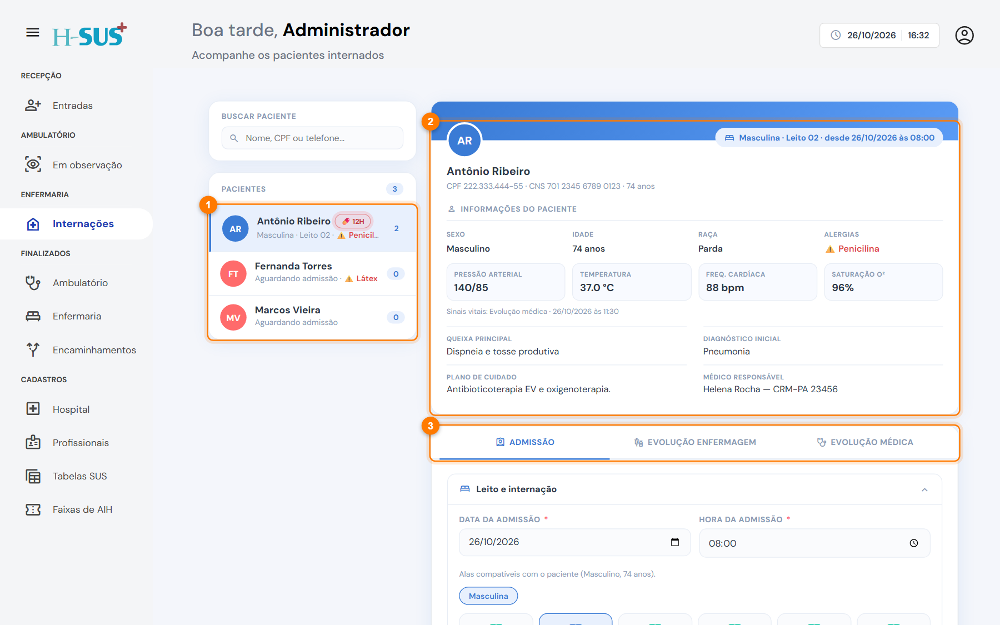
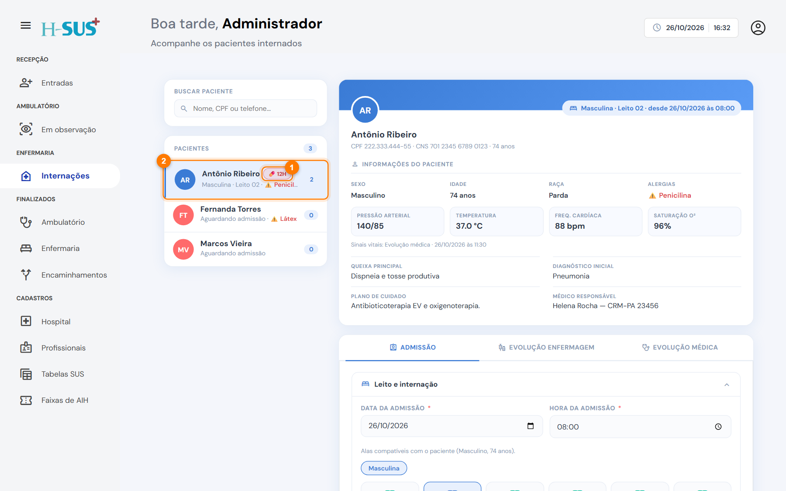

# Internações

Em **Enfermaria › Internações** ficam os pacientes encaminhados para internação, pela consulta, pela observação ou por transferência. Aqui a equipe faz a admissão no leito, as evoluções diárias e a saída da internação.

<figure><figcaption>
Tela de Internações
</figcaption></figure>

1. **Pacientes:** todos os internados. Abaixo do nome aparece o leito, ou **Aguardando admissão** para quem ainda não ocupa um leito, e as alergias em vermelho. O número à direita é a quantidade de evoluções.
2. **Resumo do paciente:** leito e data da internação, dados pessoais, alergias, os **sinais vitais mais recentes** (com a origem, por exemplo "Evolução médica"), queixa, diagnóstico inicial, plano de cuidado e médico responsável.
3. **Abas de trabalho:** Admissão, Evolução de enfermagem e Evolução médica. As abas de evolução só liberam depois que a admissão for salva.

## Alerta de medicação

Quando um paciente tem medicação aprazada para os próximos **30 minutos**, aparece o alerta **💊 horário** ao lado do nome (1). Se a dose já passou do horário sem registro, o alerta fica **vermelho**.

<figure><figcaption>
Alerta de medicação na lista de pacientes
</figcaption></figure>

Clique no alerta para abrir uma nova evolução de enfermagem com aquele horário já selecionado.

## Rotina da internação

<table data-view="cards"><thead><tr><th></th><th></th><th data-hidden data-card-cover data-type="files"></th><th data-hidden data-card-target data-type="content-ref"></th></tr></thead><tbody>
<tr><td><strong>1. Admissão</strong></td><td>Leito, acompanhante, anamnese, exame físico e plano.</td><td><a href="../imagens/adm-leito.png">adm-leito.png</a></td><td><a href="admissao.md">admissao.md</a></td></tr>
<tr><td><strong>2. Evolução de enfermagem</strong></td><td>Medicação aprazada, coletas, sinais vitais e anotações.</td><td><a href="../imagens/enf-novo-medicacoes.png">enf-novo-medicacoes.png</a></td><td><a href="evolucao-de-enfermagem.md">evolucao-de-enfermagem.md</a></td></tr>
<tr><td><strong>3. Evolução médica</strong></td><td>Avaliação, prescrição e exames.</td><td><a href="../imagens/med-novo.png">med-novo.png</a></td><td><a href="evolucao-medica.md">evolucao-medica.md</a></td></tr>
<tr><td><strong>4. Finalizar a internação</strong></td><td>Alta, óbito, transferência ou permanência.</td><td><a href="../imagens/saida-pronta.png">saida-pronta.png</a></td><td><a href="finalizar-internacao.md">finalizar-internacao.md</a></td></tr>
</tbody></table>
