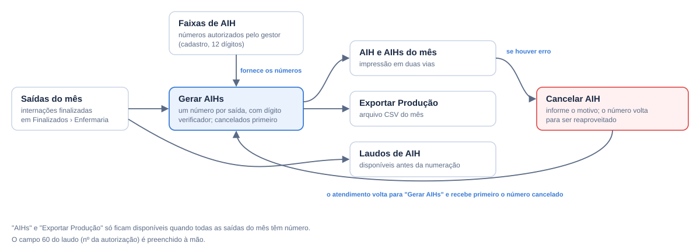
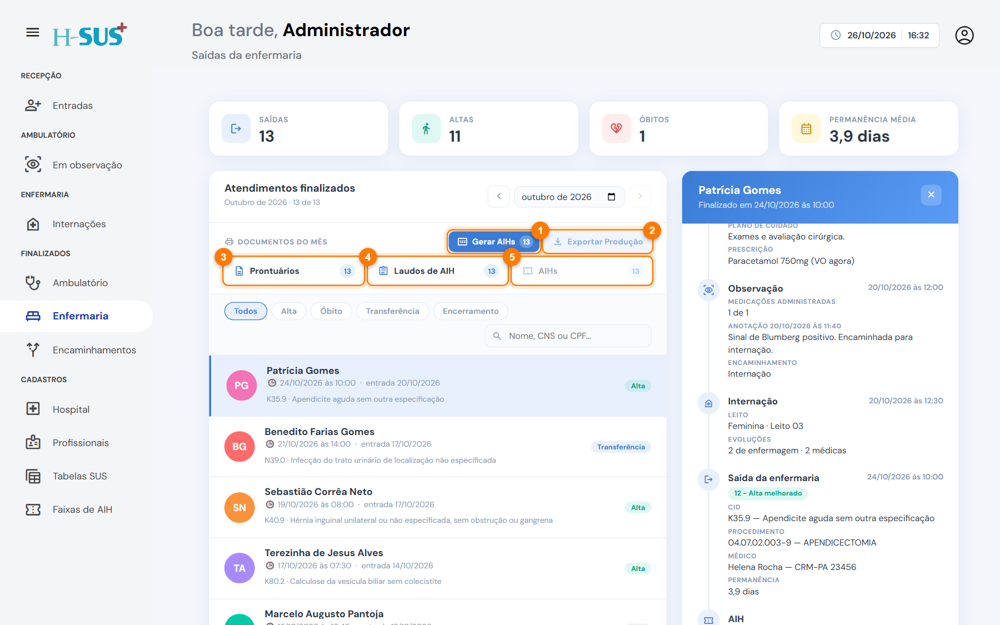
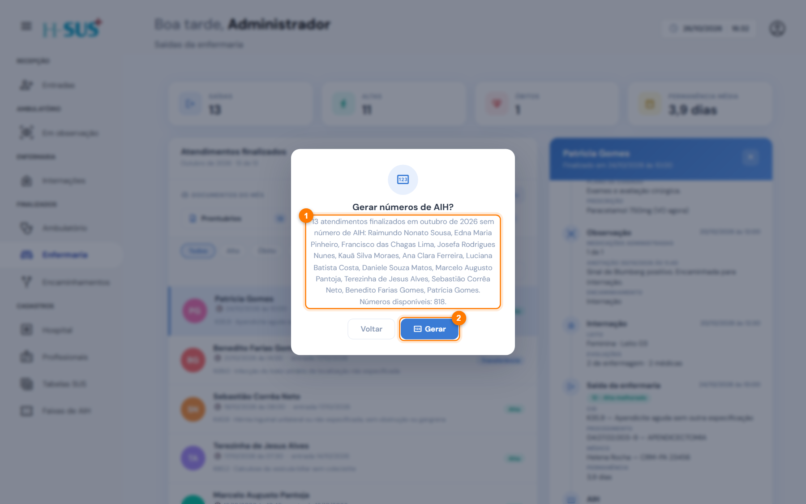
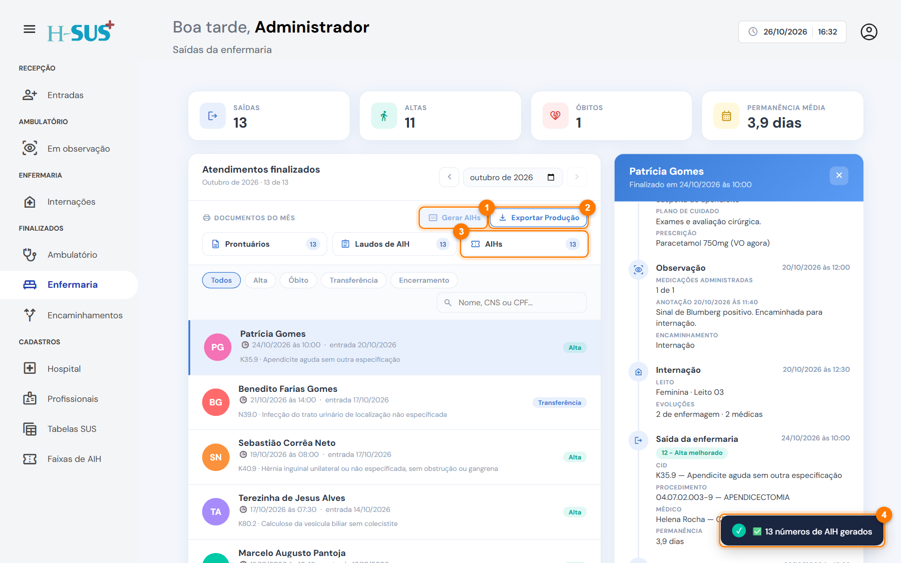
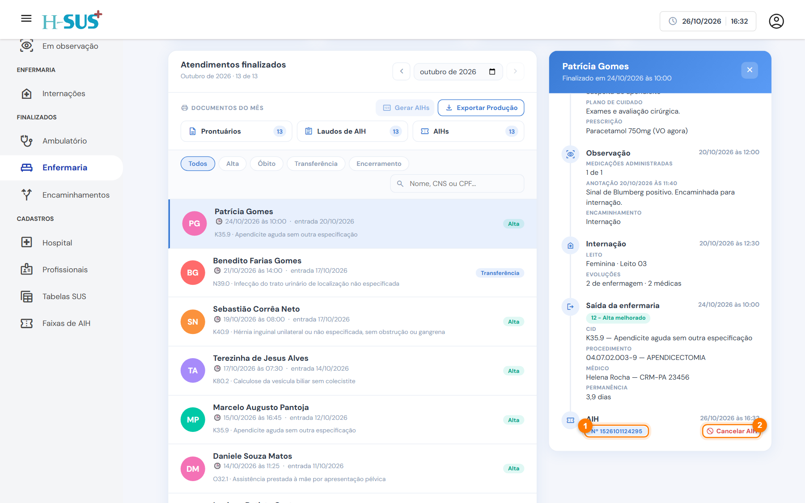
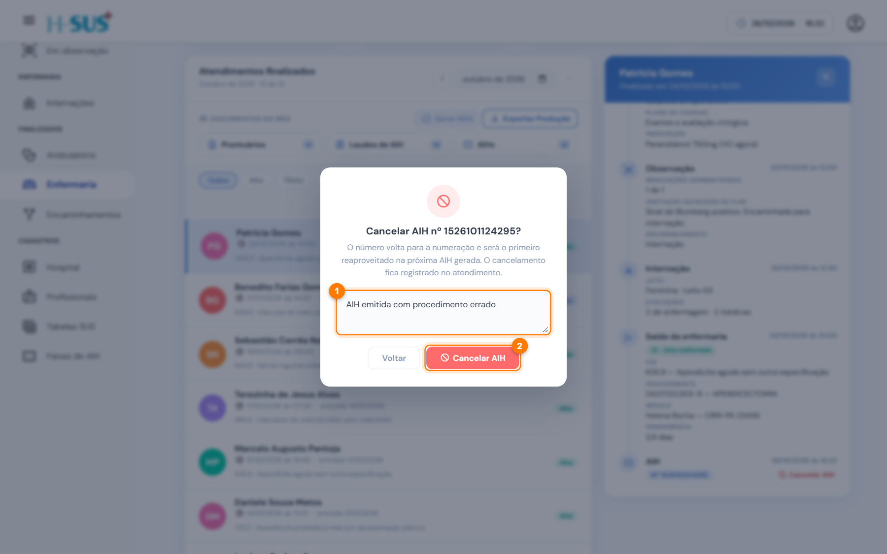
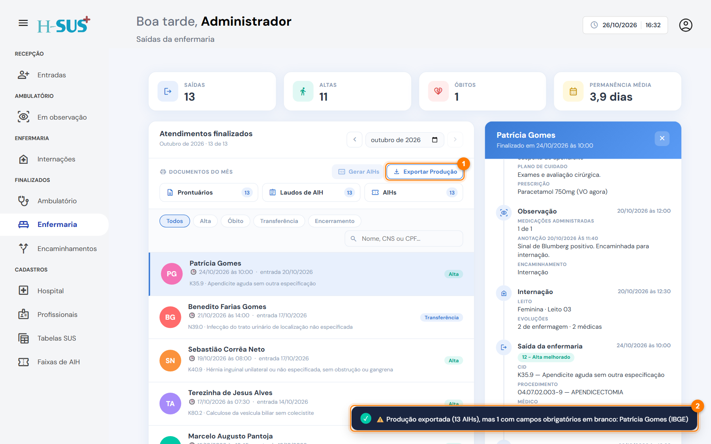

# AIH e produção do mês

No fim do mês, as internações encerradas recebem o número de AIH, a partir das [Faixas de AIH](../cadastros/faixas-de-aih.md) cadastradas. Com todas numeradas, você emite as AIHs e exporta o arquivo de produção.

<figure><figcaption>
Ciclo da AIH no H-SUS
</figcaption></figure>

## Documentos do mês

<figure><figcaption>
Botões de Documentos do mês
</figcaption></figure>

1. **Gerar AIHs:** numera as saídas do mês que ainda não têm AIH. O número no botão é a quantidade de saídas sem número.
2. **Exportar Produção:** baixa o arquivo CSV com a produção do mês.
3. **Prontuários:** todos os prontuários do mês num só documento.
4. **Laudos de AIH:** todos os laudos do mês.
5. **AIHs:** todas as AIHs do mês.


**AIHs** e **Exportar Produção** só ficam disponíveis quando **todas** as saídas do mês têm número de AIH.


## Gerar a numeração



### Clique em Gerar AIHs

Escolha o mês e clique em **Gerar AIHs**. Confira a lista de pacientes sem número e a quantidade de números disponíveis na faixa (1). Clique em **Gerar** (2).

<figure><figcaption>
Confirmação antes de gerar
</figcaption></figure>




### Confira o resultado

Um aviso confirma quantos números foram gerados (4). **Gerar AIHs** fica desabilitado (1), e **Exportar Produção** (2) e **AIHs** (3) ficam disponíveis.

<figure><figcaption>
Numeração gerada
</figcaption></figure>




Cada saída recebe um número de 13 dígitos (12 da faixa mais o dígito verificador), na ordem das saídas. Números cancelados são reaproveitados primeiro. Se a faixa acabar no meio, o sistema avisa quantos foram gerados: cadastre uma faixa nova e gere de novo.

## Cancelar uma AIH

Use quando a AIH foi emitida com erro.



### Clique em Cancelar AIH

Clique no atendimento. Na linha do tempo, ao lado do número da AIH (1), clique em **Cancelar AIH** (2).

<figure><figcaption>
Número da AIH e o botão Cancelar AIH
</figcaption></figure>




### Informe o motivo e confirme

Escreva o **motivo** (1) e clique em **Cancelar AIH** (2).

<figure><figcaption>
Cancelamento com motivo
</figcaption></figure>




O número volta para ser o primeiro reaproveitado, e o cancelamento fica registrado no atendimento. Para dar um número novo ao paciente, clique de novo em **Gerar AIHs**.

## Exportar a produção

Clique em **Exportar Produção** (1) para baixar o arquivo `producao-aih-ANO-MES.csv`. Um aviso confirma a exportação (2).

<figure><figcaption>
Produção exportada
</figcaption></figure>

O arquivo traz uma linha por AIH, em ordem de número, com os dados usados no faturamento:

* **Paciente:** CNS, nome, prontuário, nascimento, sexo, raça, mãe, responsável, endereço, CEP e código IBGE.
* **Internação:** entrada, saída, CID, procedimento, clínica, caráter e motivo da alta.
* **Médico solicitante:** CPF, CNS e CBO.
* **Número da AIH.**


Se algum campo obrigatório estiver em branco (CNS, nascimento, sexo, IBGE, CID, procedimento…), o arquivo é gerado mesmo assim e o aviso mostra quem está incompleto e o que falta. Corrija no atendimento ou no cadastro e exporte de novo.

