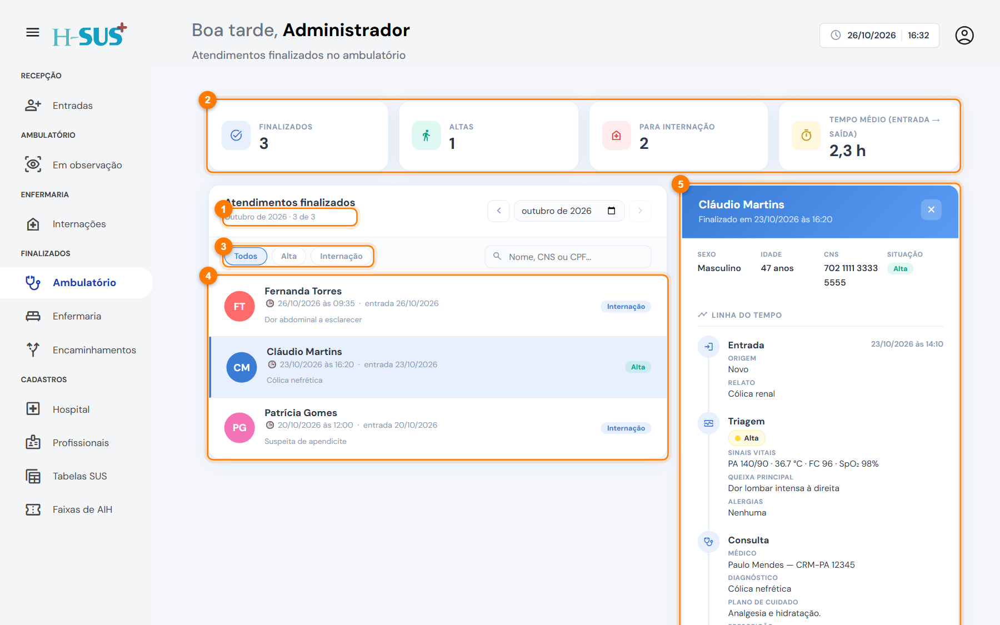

# Ambulatório

Em **Finalizados › Ambulatório** ficam os pacientes que saíram da [observação](../ambulatorio/em-observacao.md), com **alta** ou encaminhados para **internação**.

<figure><figcaption>
Finalizados › Ambulatório
</figcaption></figure>

## Indicadores do mês

| Indicador           | O que conta                                                        |
| ------------------- | ------------------------------------------------------------------ |
| **Finalizados**     | Todos os atendimentos que saíram da observação no mês              |
| **Altas**           | Saídas com alta                                                    |
| **Para internação** | Pacientes encaminhados da observação para a enfermaria             |
| **Tempo médio**     | Média do tempo entre a entrada no hospital e a saída da observação |

## Filtros

**Todos**, **Alta** e **Internação**.

No detalhe, a linha do tempo mostra a entrada, a triagem, a consulta e a observação: medicações administradas, procedimentos, anotações e o encaminhamento final.

Para usar o mês, a busca e o detalhe, veja [Como usar os finalizados](como-usar.md).
