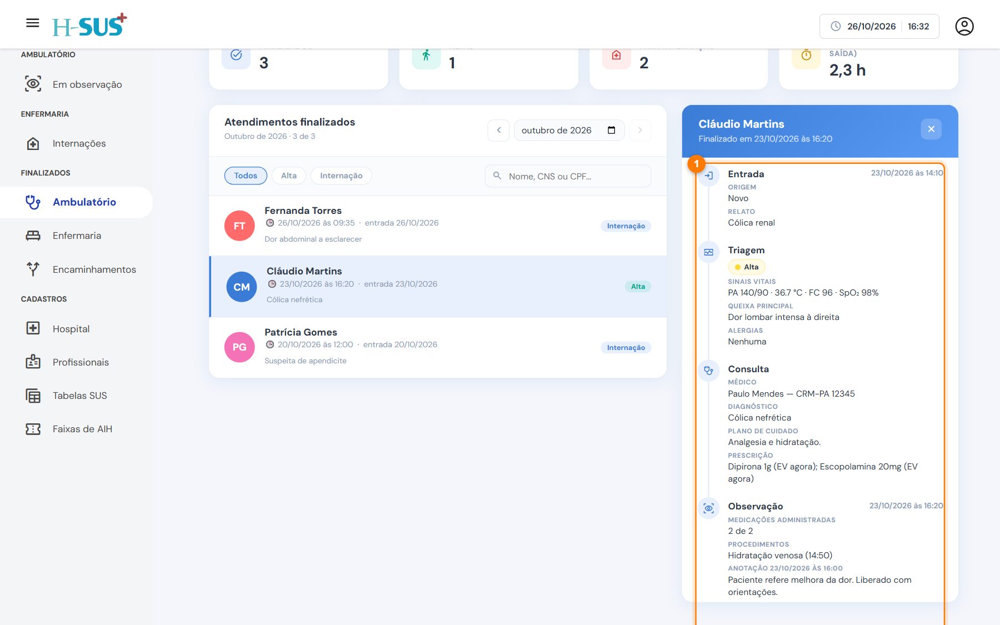

# Como usar os finalizados

As três telas de **Finalizados** (Ambulatório, Enfermaria e Encaminhamentos) funcionam da mesma forma. Elas mostram os atendimentos encerrados **em um mês**, contados pela data de saída.

<figure><figcaption>
Partes de uma tela de finalizados
</figcaption></figure>

1. **Mês:** use as setas para ir ao mês anterior ou ao próximo, ou clique no mês para escolher no calendário. A tela abre no mês atual.
2. **Indicadores:** totais do mês, como saídas, altas e tempo médio.
3. **Filtros:** mostram só um tipo de saída. **Todos** volta a lista completa. Ao lado, a busca aceita nome, CNS ou CPF.
4. **Lista:** os atendimentos do mês, do mais recente para o mais antigo, com a data da saída, a data de entrada e um resumo (diagnóstico ou CID).
5. **Detalhe:** clique em um atendimento para ver os dados do paciente e a linha do tempo. O **×** fecha o detalhe.

## Linha do tempo

A linha do tempo (1) mostra, em ordem, tudo o que aconteceu no atendimento: entrada, triagem, consulta, observação, internação e saída, com datas, profissionais e registros.

<figure><figcaption>
Linha do tempo de um atendimento
</figcaption></figure>


As telas de finalizados servem para consulta: o que foi registrado não é alterado aqui. A exceção é a numeração das AIHs, em [Finalizados › Enfermaria](enfermaria.md).

