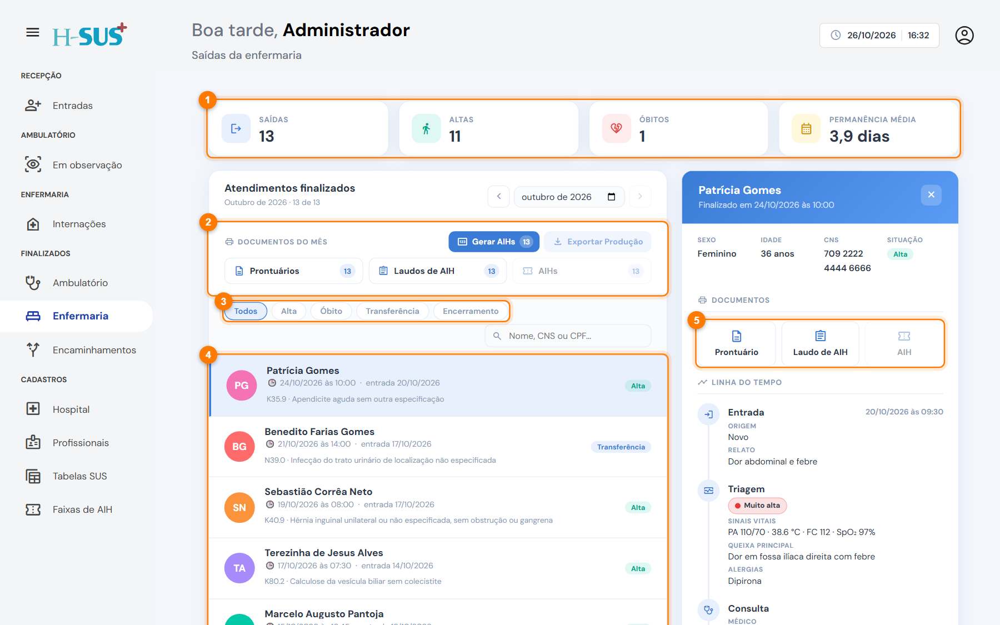
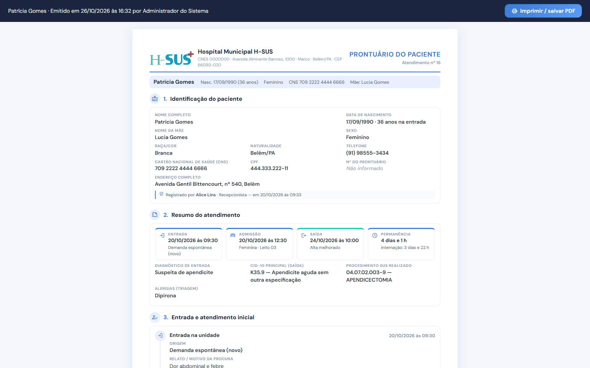
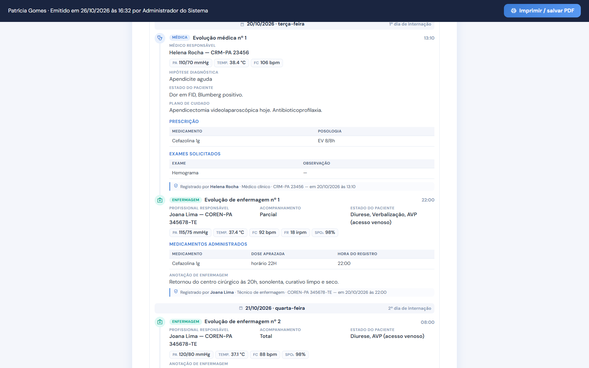
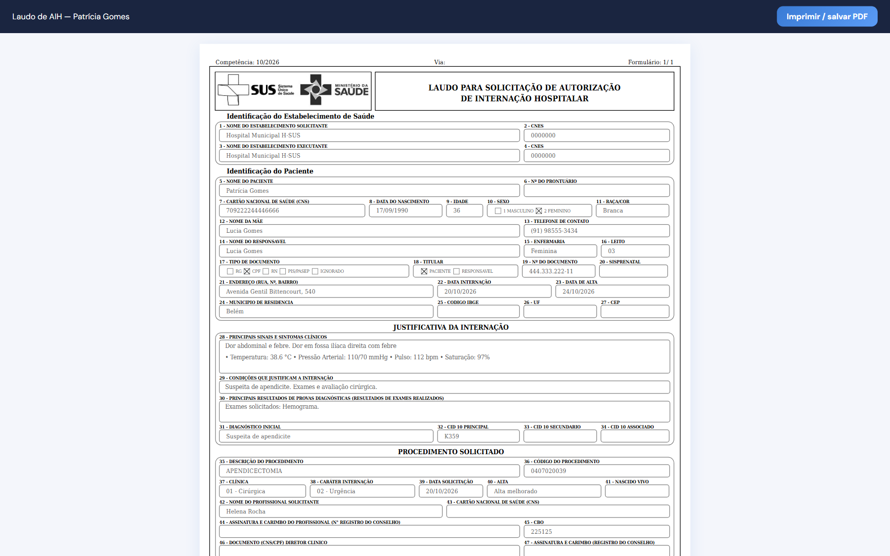
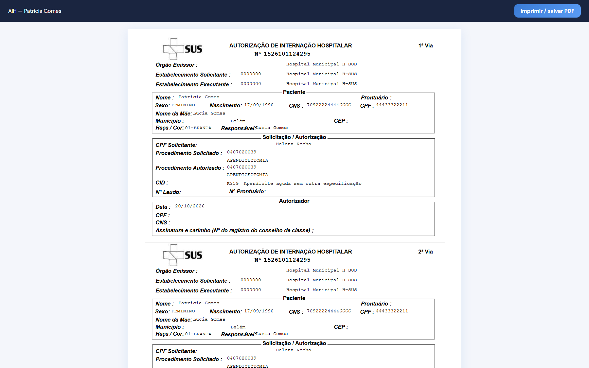

# Documentos do paciente

Para cada internação finalizada, o sistema gera três documentos oficiais, prontos para imprimir ou salvar em PDF.



### Escolha o atendimento

Em **Finalizados › Enfermaria**, clique no atendimento. Os botões ficam em **Documentos do paciente** (5).

<figure><figcaption>
Botões dos documentos do paciente
</figcaption></figure>




### Clique no documento

Clique em **Prontuário**, **Laudo de AIH** ou **AIH**. O documento abre em uma nova janela.



### Imprima ou salve em PDF

Clique em **Imprimir / salvar PDF**, no alto da janela do documento.




Se nada abrir, o navegador bloqueou a janela. Libere os **pop-ups** para o endereço do H-SUS e clique de novo.


Para emitir os documentos de **todas as saídas do mês** de uma vez, use os botões de **Documentos do mês**. Veja [AIH e produção do mês](aih-e-producao.md).

## Prontuário

Reproduz **tudo o que foi registrado** no atendimento, conforme a Resolução CFM 1.638/2002 e as normas do COFEN.

<figure><figcaption>
Prontuário do paciente: identificação e resumo
</figcaption></figure>

* Identificação completa e resumo do atendimento (entrada, admissão, saída e permanência).
* Entrada, triagem, consulta e observação.
* Admissão de enfermagem, aprazamento e **evolução diária**, organizada por dia de internação.
* Saída da internação e lista de profissionais responsáveis, com espaço para assinatura.

Cada registro mostra **quem lançou e quando**. Evoluções lançadas depois do horário, retificadas ou excluídas aparecem identificadas, com o motivo.

<figure><figcaption>
Evolução diária no prontuário
</figcaption></figure>

## Laudo de AIH

O laudo para solicitação de autorização de internação hospitalar, no modelo oficial. O sistema preenche os campos com os dados do atendimento e do [cadastro do Hospital](../cadastros/hospital.md) (diretor clínico e autorizador).

<figure><figcaption>
Laudo para solicitação de AIH
</figcaption></figure>

* A **clínica** (campo 37) é deduzida pela ala e pelo procedimento: cirúrgica, obstétrica, clínica médica ou pediatria.
* O campo **60 (nº da autorização)** sai em branco e é preenchido à mão.
* O laudo pode ser emitido antes da numeração das AIHs.

## AIH

A Autorização de Internação Hospitalar, em **duas vias** na mesma folha, com o número da AIH. O botão **AIH** só fica disponível depois que o número é gerado em **Gerar AIHs** (veja [AIH e produção do mês](aih-e-producao.md)).

<figure><figcaption>
AIH com o número gerado
</figcaption></figure>
