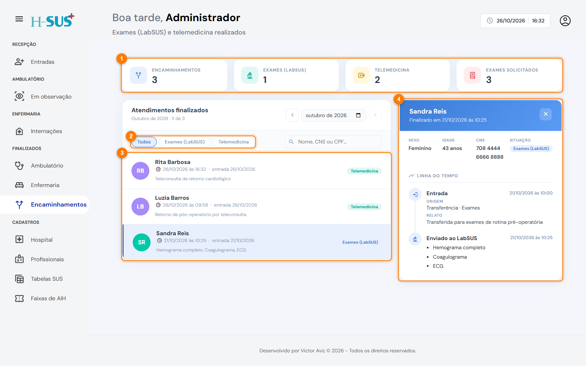

# Encaminhamentos

Em **Finalizados › Encaminhamentos** ficam as transferências com destino **Exames** (enviadas ao LabSUS) e **Telemedicina** (registradas). A recepção também tem acesso a esta tela.

<figure><figcaption>
Finalizados › Encaminhamentos
</figcaption></figure>

1. **Indicadores:** total de encaminhamentos, quantos foram para exames, quantos para telemedicina e o número de exames solicitados.
2. **Filtros:** **Todos**, **Exames (LabSUS)** e **Telemedicina**.
3. **Lista:** cada encaminhamento mostra a data, o tipo e os exames pedidos.
4. **Detalhe:** a linha do tempo com a entrada, os exames solicitados e a data do envio ou do registro.

Para usar o mês, a busca e o detalhe, veja [Como usar os finalizados](como-usar.md).
