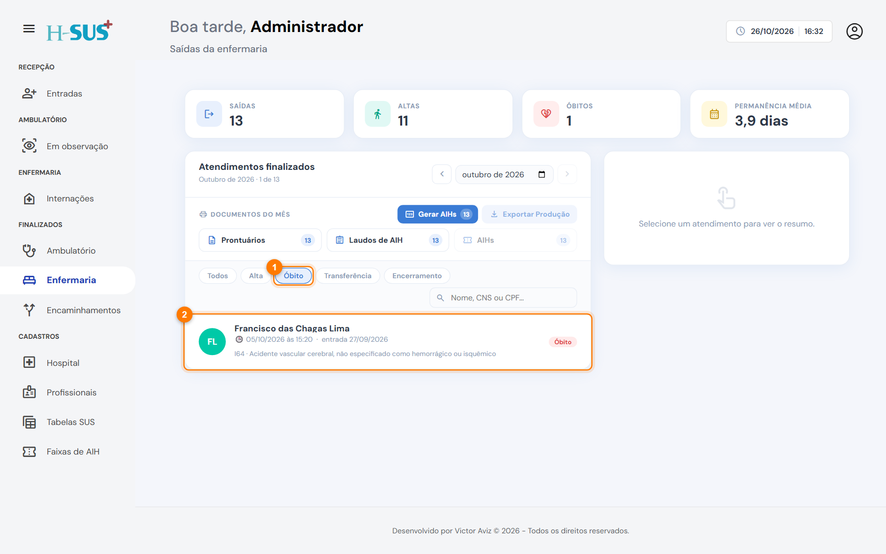
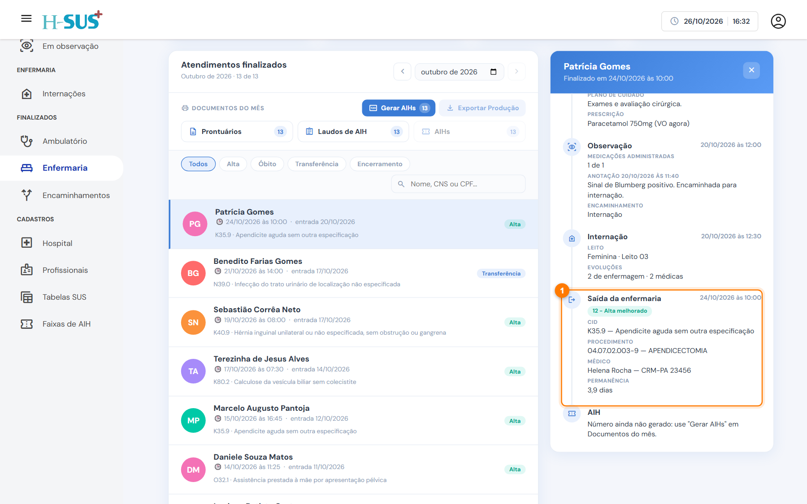

# Enfermaria

Em **Finalizados › Enfermaria** ficam as internações encerradas: alta, óbito, transferência ou encerramento. É nesta tela que você emite os **documentos oficiais** e gera a **AIH** e a **produção do mês**.

<figure><figcaption>
Finalizados › Enfermaria
</figcaption></figure>

1. **Indicadores do mês:** saídas, altas, óbitos e permanência média.
2. **Documentos do mês:** emite os documentos de todas as saídas do mês de uma vez e gera a numeração das AIHs. Veja [AIH e produção do mês](aih-e-producao.md).
3. **Filtros:** **Todos**, **Alta**, **Óbito**, **Transferência** e **Encerramento**.
4. **Lista:** cada saída mostra a data, a entrada, o CID e o tipo de saída.
5. **Documentos do paciente:** prontuário, laudo de AIH e AIH do atendimento selecionado. Veja [Documentos do paciente](documentos.md).

| Indicador | O que conta |
| --- | --- |
| **Saídas** | Internações encerradas no mês |
| **Altas** | Saídas com alta, inclusive as altas obstétricas (61 a 64) |
| **Óbitos** | Saídas por óbito, inclusive os obstétricos (65 a 67) |
| **Permanência média** | Média do tempo entre a admissão e a saída |

## Filtrar por tipo de saída

Clique no filtro, por exemplo **Óbito** (1), para ver só aquelas saídas (2).

<figure><figcaption>
Filtro Óbito aplicado
</figcaption></figure>

## Linha do tempo da internação

No detalhe, a linha do tempo mostra a entrada, a triagem, a consulta, a observação (quando houve), a internação (leito e número de evoluções), a **saída** (1) com motivo, CID, procedimento, médico e permanência, e a **AIH**.

<figure><figcaption>
Saída da enfermaria na linha do tempo
</figcaption></figure>

