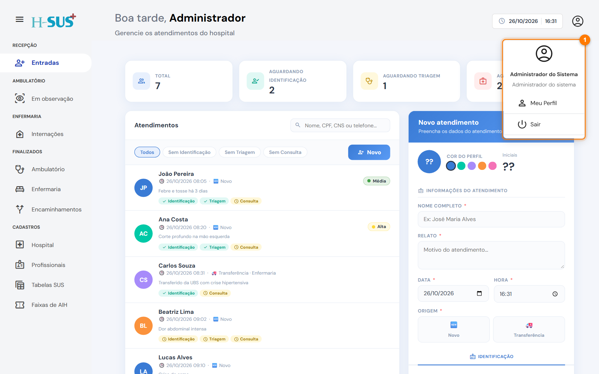

# Acessar o sistema

Cada profissional tem o próprio usuário e senha, criados pelo administrador em [Profissionais](../cadastros/profissionais.md). Tudo o que você registra fica assinado com o seu nome, por isso nunca use o acesso de outra pessoa.

## Entrar



### Preencha usuário e senha

Digite seu **usuário** (1) e sua **senha** (2). O ícone de olho mostra ou esconde a senha.

Se o computador for só seu, deixe marcado **Lembrar de mim** (3): na próxima vez o usuário já vem preenchido. A senha nunca fica salva.

<figure><figcaption>
Tela de login
</figcaption></figure>




### Clique em Entrar

Clique em **Entrar** (4). Você vai direto para a primeira tela liberada para o seu perfil.



### Se aparecer uma mensagem de erro

A mensagem aparece acima do botão (1). Confira o usuário e a senha e tente de novo.

<figure><figcaption>
Usuário ou senha incorretos
</figcaption></figure>




| Mensagem ou link                | O que fazer                                                            |
| ------------------------------- | ---------------------------------------------------------------------- |
| **Usuário ou senha incorretos** | Confira o usuário e a senha (maiúsculas e minúsculas contam na senha). |
| **Usuário inativo**             | Seu acesso foi desativado. Procure o administrador do sistema.         |
| **Esqueceu a senha?**           | O administrador define uma senha nova para você em Profissionais.      |
| **Solicitar acesso**            | Peça ao administrador que crie o seu cadastro.                         |


O fundo da tela de login muda a cada hora, com fotos de cuidado em hospitais.


## Sair

Clique no ícone de usuário, no canto superior direito, e escolha **Sair** (1).

<figure><figcaption>
Menu do usuário com a opção Sair
</figcaption></figure>


Sempre saia do sistema ao terminar o plantão ou ao deixar o computador. Ao fechar a aba ou o navegador, o sistema também pede o login de novo.

