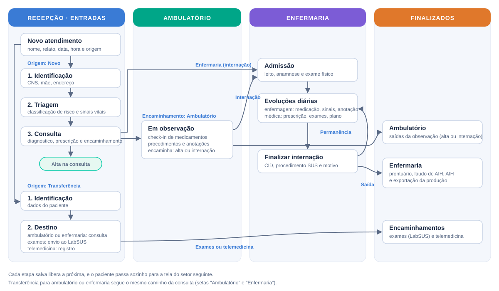

# Caminho do paciente

Todo atendimento começa na **Recepção**, em Entradas. A partir dali, o paciente passa sozinho para a tela do setor seguinte assim que cada etapa é salva. Ninguém precisa "mandar" o paciente de uma tela para outra.

<figure><figcaption>
Caminho do paciente, da entrada até os finalizados
</figcaption></figure>



Paciente que procurou o hospital por conta própria.

1. **Recepção:** abre o atendimento e faz a [Identificação](../recepcao/identificacao.md).
2. **Triagem:** a enfermagem classifica o risco e registra os sinais vitais ([Triagem](../recepcao/triagem.md)).
3. **Consulta:** o médico registra o diagnóstico, a prescrição e o **encaminhamento** ([Consulta](../recepcao/consulta.md)):
   * **Ambulatório:** o paciente vai para [Em observação](../ambulatorio/em-observacao.md).
   * **Enfermaria:** o paciente vai para [Internações](../enfermaria/internacoes.md), aguardando admissão.
   * **Alta:** o atendimento termina ali.



Paciente encaminhado por outra unidade. Depois da identificação, segue para o destino escolhido:

* **Ambulatório** ou **Enfermaria:** o médico registra a consulta e o paciente vai para Em observação ou para Internações.
* **Exames:** os exames são enviados ao LabSUS e o atendimento vai para [Finalizados › Encaminhamentos](../finalizados/encaminhamentos.md).
* **Telemedicina:** o atendimento é registrado e também vai para Encaminhamentos.



* **Em observação:** o paciente sai com **alta** ou é encaminhado para **internação**. Nos dois casos, o atendimento aparece em [Finalizados › Ambulatório](../finalizados/ambulatorio.md).
* **Internação:** depois da admissão vêm as evoluções diárias. Ao [finalizar a internação](../enfermaria/finalizar-internacao.md) (alta, óbito, transferência…), o leito é liberado e o atendimento vai para [Finalizados › Enfermaria](../finalizados/enfermaria.md), onde ficam os documentos e a AIH.




Na lista de Entradas, cada atendimento mostra etiquetas com as etapas: verdes com ✓ para as concluídas e amarelas com relógio para as que faltam.

