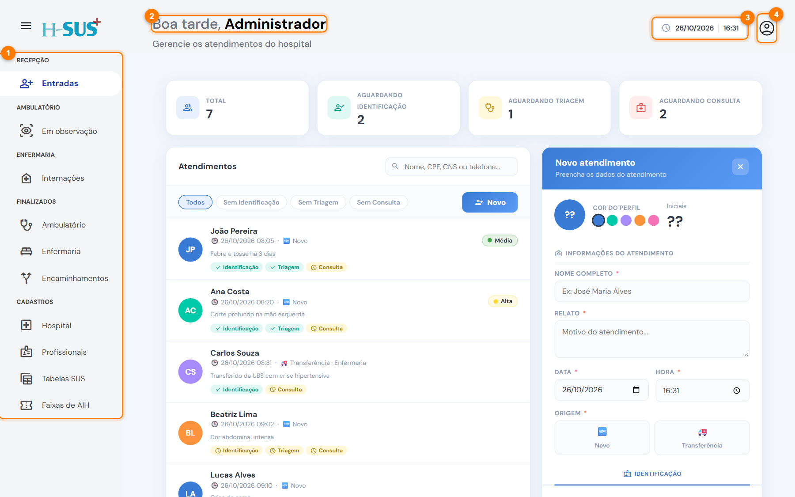
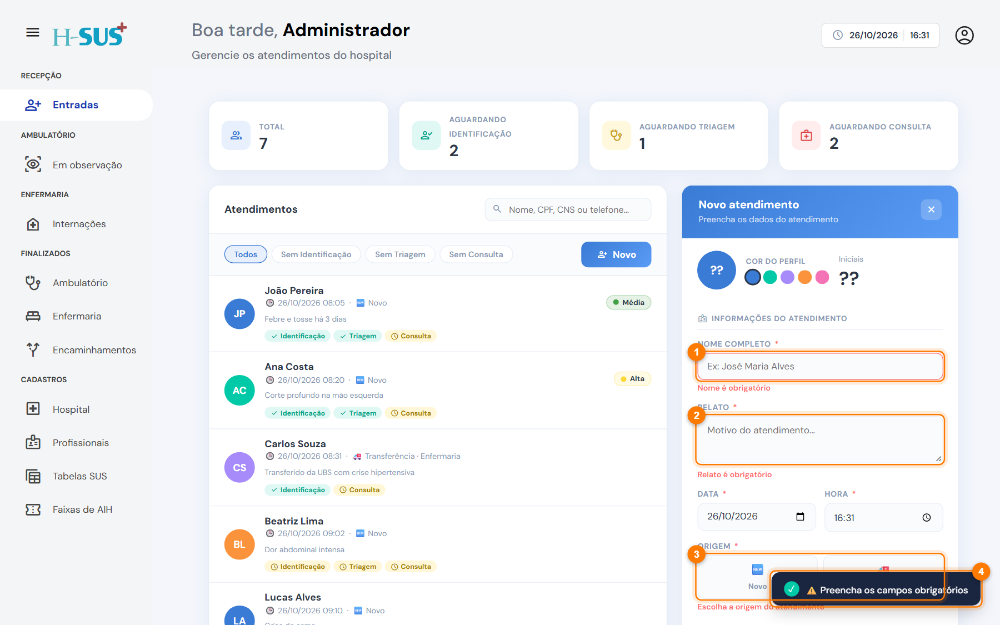

# Conhecer a tela

Todas as telas do H-SUS seguem o mesmo desenho. Conhecendo as partes abaixo, você se localiza em qualquer uma delas.

<figure><figcaption>
Partes fixas da tela
</figcaption></figure>

1. **Menu lateral:** leva às telas do sistema, agrupadas por setor (Recepção, Ambulatório, Enfermaria, Finalizados e Cadastros). A tela aberta fica destacada. O botão de três linhas, ao lado da logo, recolhe ou abre o menu.
2. **Saudação:** mostra seu nome e, logo abaixo, para que serve a tela aberta.
3. **Data e hora:** o relógio do sistema, referência de horário dos registros.
4. **Usuário:** mostra seu nome e cargo e tem a opção **Sair**.

## Padrões que se repetem



**Lista à esquerda, formulário à direita.** Na maioria das telas, você escolhe o paciente na lista e trabalha nos dados dele no painel ao lado.

**Busca e filtros.** A busca aceita nome, CPF, CNS ou telefone. Os botões arredondados acima da lista (filtros) mostram só um grupo de pacientes.

**Abas com cadeado.** Uma aba com cadeado só libera depois que a etapa anterior for salva e concluída.



**Salvar e Descartar.** Nada é gravado até você clicar em **Salvar**. **Descartar** ou **Limpar** desfaz o que ainda não foi salvo.

**Avisos.** Depois de cada ação aparece uma mensagem curta no canto da tela, confirmando o que foi feito ou explicando o que falta.

**Check-ins.** As marcações de medicação administrada e de exame coletado são gravadas na hora, sem precisar clicar em Salvar.



## Campos obrigatórios

Campos com **asterisco (\*)** são obrigatórios. Se você tentar salvar sem eles, o campo fica vermelho e uma mensagem explica o que falta.

<figure><figcaption>
Campos obrigatórios em vermelho e o aviso no canto da tela
</figcaption></figure>

1. **Nome completo** em vermelho: precisa ser preenchido.
2. **Relato** em vermelho: precisa ser preenchido.
3. **Origem:** também obrigatória.
4. **Aviso:** a mensagem que explica o que falta.
