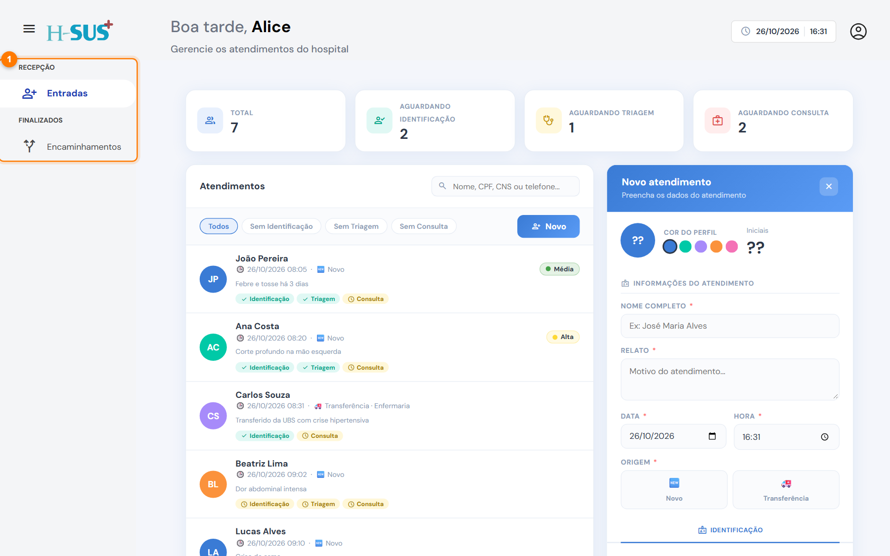

# Perfis de acesso

O menu lateral mostra só as telas liberadas para o seu perfil. O perfil é definido pelo administrador no cadastro de [Profissionais](../cadastros/profissionais.md).

| Tela | Administrador | Médico | Enfermagem | Recepção |
| --- | :---: | :---: | :---: | :---: |
| Recepção › Entradas | ✅ | ✅ | ✅ | ✅ |
| Ambulatório › Em observação | ✅ | ✅ | ✅ | — |
| Enfermaria › Internações | ✅ | ✅ | ✅ | — |
| Finalizados › Ambulatório | ✅ | ✅ | ✅ | — |
| Finalizados › Enfermaria | ✅ | ✅ | ✅ | — |
| Finalizados › Encaminhamentos | ✅ | ✅ | ✅ | ✅ |
| Cadastros (Hospital, Profissionais, Tabelas SUS, Faixas de AIH) | ✅ | — | — | — |

Por exemplo, um usuário da **recepção** vê só Entradas e Encaminhamentos (1):

<figure><figcaption>
Menu de um usuário com perfil Recepção
</figcaption></figure>

## Quem assina o quê

* Cada registro guarda **quem lançou** (o usuário conectado) e **quando**. Essas informações aparecem no prontuário.
* Os campos de **profissional responsável** (médico da consulta, profissional da evolução etc.) vêm preenchidos com o usuário conectado. Se outra pessoa fez o atendimento, escolha o nome dela na lista.
* Médicos e profissionais de enfermagem precisam ter o **conselho e o número de registro** (CRM, COREN) no cadastro, porque assinam registros clínicos.


Só quem lançou uma evolução, ou o administrador, pode editá-la ou excluí-la. Veja [Editar ou excluir uma evolução](../enfermaria/editar-ou-excluir-evolucao.md).

