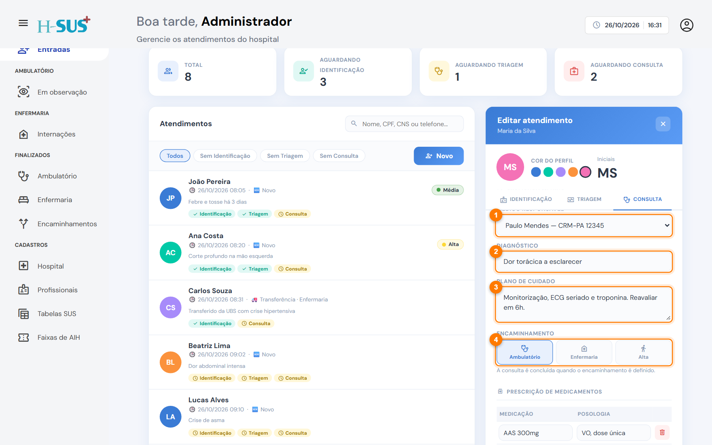
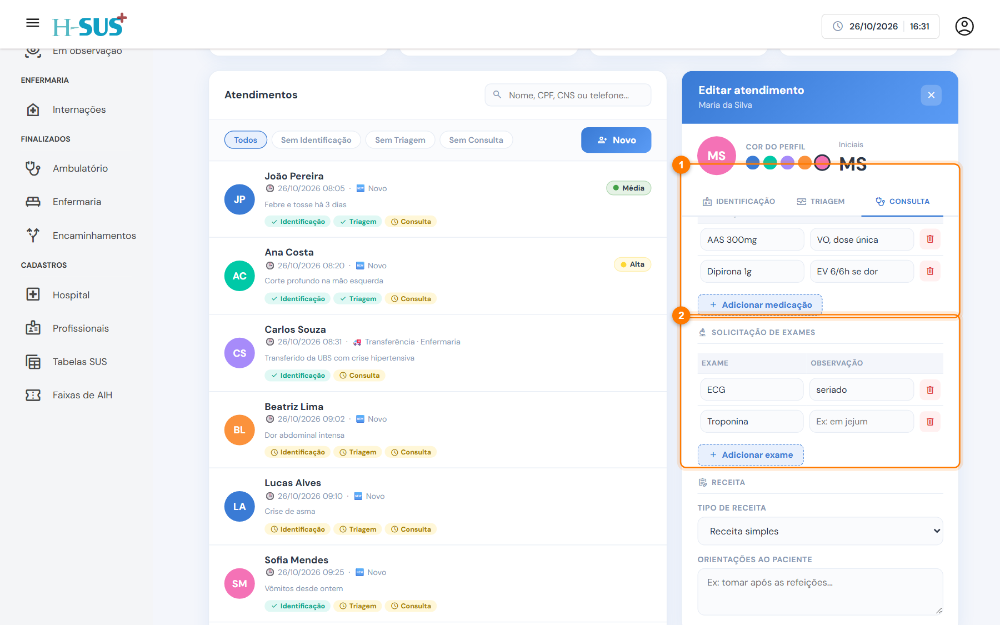
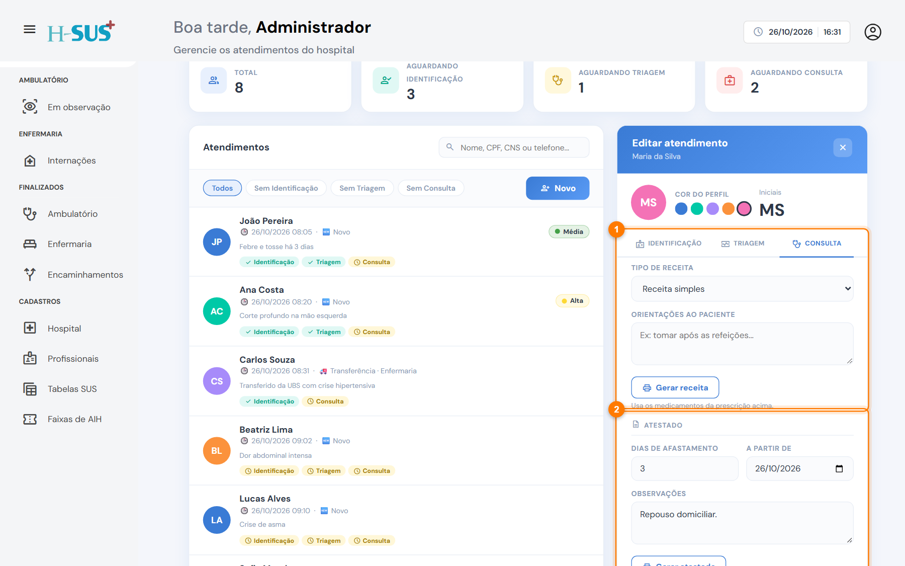
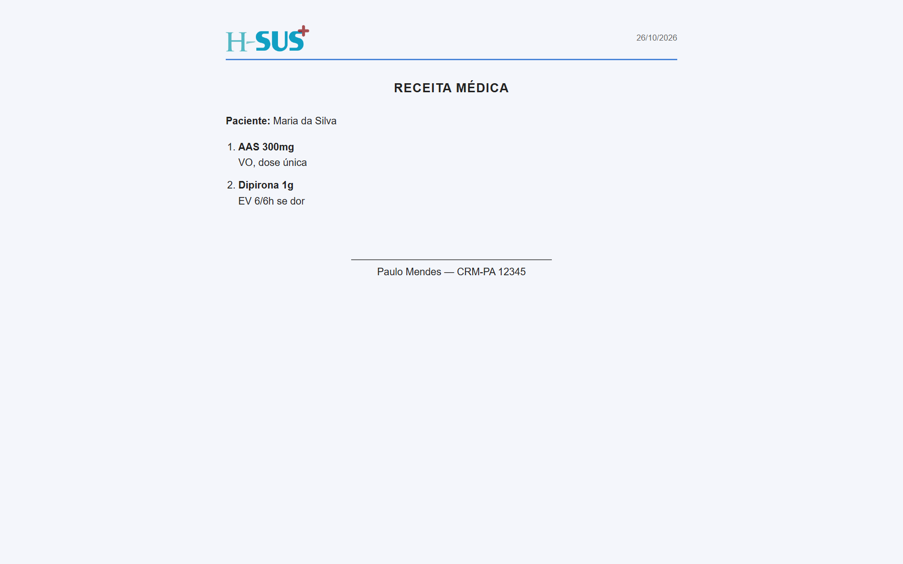
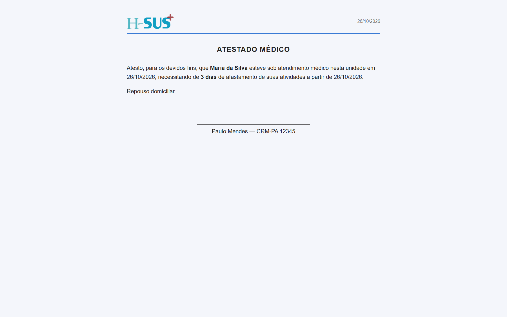

# Consulta

Na consulta, o médico registra o diagnóstico, a prescrição e os exames e decide o **encaminhamento** do paciente. O encaminhamento define para qual setor o paciente vai.



### Registre a avaliação e o encaminhamento

Abra o atendimento e clique na aba **Consulta**.

<figure><figcaption>
Avaliação médica e encaminhamento
</figcaption></figure>

1. Confira o **médico responsável**. Ele vem com o médico conectado; se a consulta foi de outro médico, escolha o nome na lista.
2. Escreva o **diagnóstico**.
3. Escreva o **plano de cuidado**: condutas, cuidados e orientações.
4. Escolha o **encaminhamento**:
   * **Ambulatório:** o paciente fica em observação e vai para [Em observação](../ambulatorio/em-observacao.md).
   * **Enfermaria:** o paciente será internado e vai para [Internações](../enfermaria/internacoes.md), aguardando admissão.
   * **Alta:** o atendimento termina aqui.



### Prescreva os medicamentos e peça os exames

<figure><figcaption>
Prescrição e solicitação de exames
</figcaption></figure>

1. Em **Prescrição de medicamentos**, clique em **Adicionar medicação** e preencha a medicação e a posologia. Repita para cada uma. A lixeira remove a linha.
2. Em **Solicitação de exames**, clique em **Adicionar exame** para cada exame, com uma observação se precisar (por exemplo, "em jejum").



### Gere a receita e o atestado, se precisar

<figure><figcaption>
Receita e atestado
</figcaption></figure>

1. **Receita:** escolha o tipo (**simples** ou **controle especial**), escreva as orientações e clique em **Gerar receita**. A receita usa os medicamentos da prescrição.
2. **Atestado:** informe os **dias de afastamento**, a data de início e as observações e clique em **Gerar atestado**.
3. Clique em **Salvar** para gravar a consulta.




A consulta fica concluída quando o encaminhamento é definido. O paciente sai da lista de Entradas e aparece no setor escolhido.


## Receita e atestado prontos para imprimir

Os documentos abrem em uma nova janela, com o botão **Imprimir / salvar PDF**.



<figure><figcaption>
Receita médica
</figcaption></figure>



<figure><figcaption>
Atestado médico
</figcaption></figure>



## Para onde vão a prescrição e os exames

* No **ambulatório**, os medicamentos aparecem para o check-in de administração.
* Na **enfermaria**, os medicamentos aparecem para o check-in na admissão e entram no aprazamento. Os exames aparecem para o check-in de coleta.
