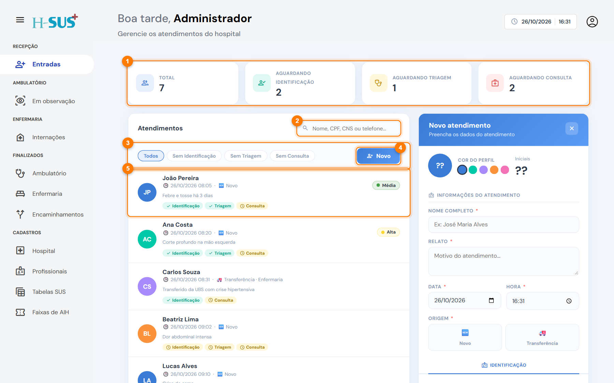
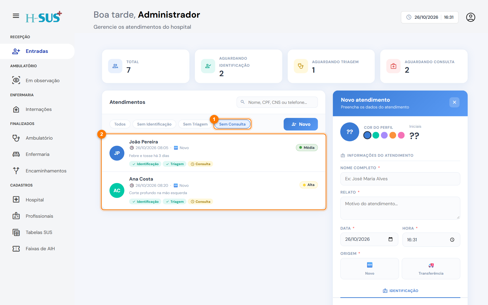
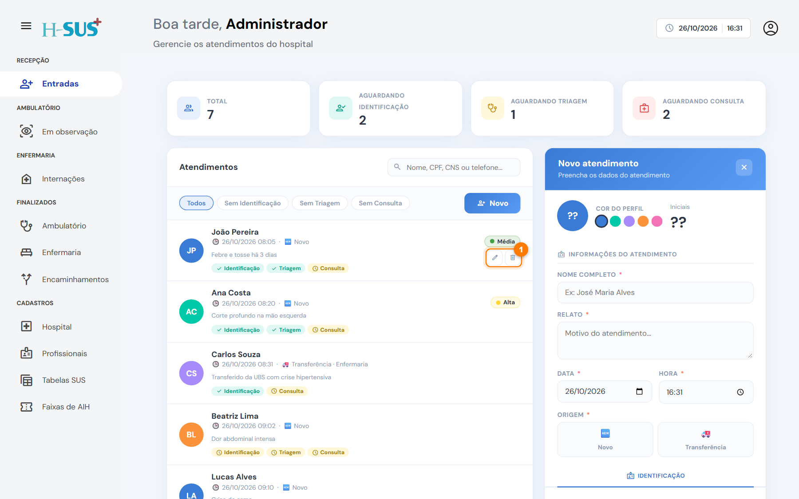
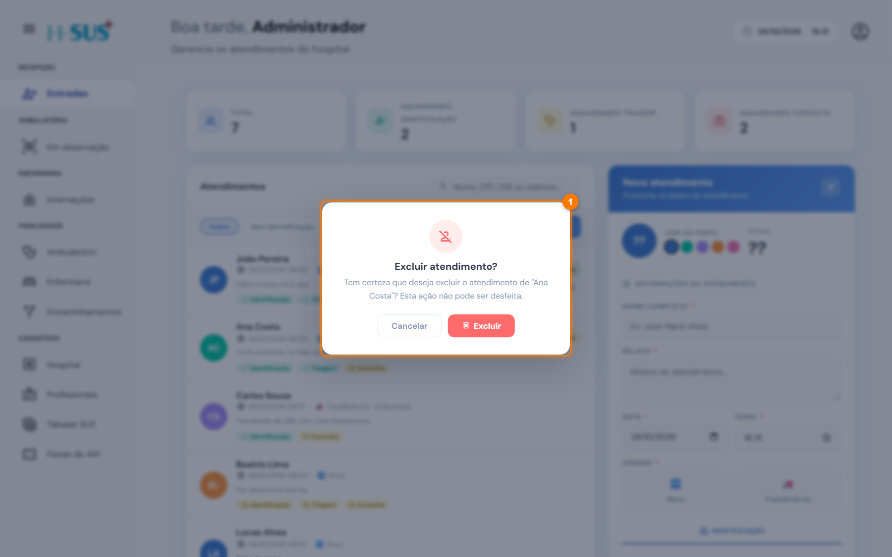

# Entradas

Em **Recepção › Entradas** você abre os atendimentos e acompanha quem ainda está passando pela recepção: identificação, triagem e consulta. Quando o atendimento é concluído, o paciente sai desta lista e segue para o setor de destino.

<figure><figcaption>
Tela de Entradas
</figcaption></figure>

1. **Resumo:** total de atendimentos na recepção e quantos aguardam identificação, triagem ou consulta.
2. **Busca:** procure por nome, CPF, CNS, telefone ou uma palavra do relato.
3. **Filtros:** **Sem Identificação**, **Sem Triagem** ou **Sem Consulta** mostram só quem espera aquela etapa. **Todos** volta a lista completa.
4. **Novo:** abre um atendimento em branco no formulário à direita.
5. **Atendimento:** clique em um item para abri-lo no formulário.

## O que cada item da lista mostra

* **Iniciais e cor** do paciente, nome, data e hora da chegada.
* **Origem:** 🆕 Novo ou 🚑 Transferência (com o destino).
* **Relato:** o motivo da procura.
* **Etapas:** etiquetas verdes com ✓ para o que já foi concluído e amarelas com relógio para o que falta.
* **Classificação de risco** à direita, depois da triagem.

## Encontrar quem espera uma etapa

Clique no filtro da etapa. Por exemplo, **Sem Consulta** (1) mostra só os pacientes já triados que aguardam o médico (2).

<figure><figcaption>
Filtro Sem Consulta aplicado
</figcaption></figure>

## Editar ou excluir um atendimento

Ao passar o mouse sobre um item aparecem os botões **Editar** (lápis) e **Excluir** (lixeira) (1).

<figure><figcaption>
Botões Editar e Excluir no item da lista
</figcaption></figure>

Para excluir, clique na lixeira e confirme em **Excluir** (1). Use só para atendimentos abertos por engano.

<figure><figcaption>
Confirmação da exclusão
</figcaption></figure>


A exclusão não pode ser desfeita. Se o paciente já foi atendido, não exclua: registre o que aconteceu no próprio atendimento.


## Próximos passos

<table data-view="cards"><thead><tr><th></th><th></th><th data-hidden data-card-target data-type="content-ref"></th></tr></thead><tbody><tr><td><strong>🆕 Novo atendimento</strong></td><td>Paciente que chegou ao hospital por conta própria.</td><td><a href="novo-atendimento.md">novo-atendimento.md</a></td></tr><tr><td><strong>🚑 Transferência</strong></td><td>Paciente encaminhado por outra unidade.</td><td><a href="transferencia.md">transferencia.md</a></td></tr></tbody></table>
