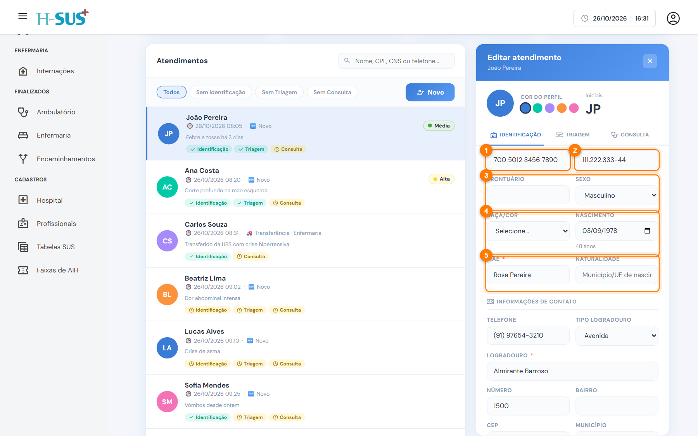
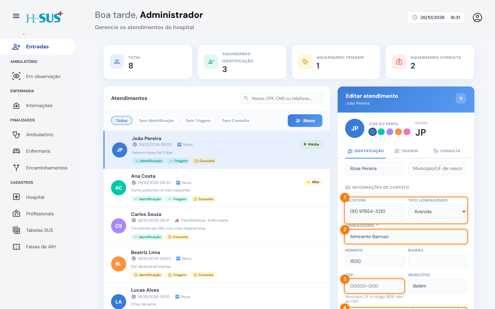

# Identificação

A identificação traz os dados pessoais do paciente. Eles aparecem em todos os documentos (prontuário, laudo de AIH, AIH e produção), por isso preencha com atenção.



### Abra o atendimento na aba Identificação

Clique no paciente na lista de Entradas. A aba **Identificação** já vem aberta.



### Preencha documentos e dados pessoais

<figure><figcaption>
Documentos e dados pessoais
</figcaption></figure>

1. **CNS** (Cartão Nacional de Saúde). Ao digitar, o sistema sugere pacientes já cadastrados.
2. **CPF**, se houver. Ele também busca pacientes já atendidos.
3. **Prontuário** e **sexo**.
4. **Raça/cor** e **nascimento**. A idade aparece logo abaixo da data.
5. **Nome da mãe** e **naturalidade** (município/UF de nascimento).



### Preencha o contato e o endereço

<figure><figcaption>
Contato e endereço
</figcaption></figure>

1. **Telefone** e **tipo de logradouro** (rua, travessa, avenida, vila, fazenda).
2. **Logradouro**, depois número e bairro.
3. **CEP.** Com internet, município, UF e código IBGE são preenchidos sozinhos.
4. **UF** e **código IBGE do município.** Sem internet, preencha à mão.
5. Clique em **Salvar**.




A identificação fica concluída com **CNS**, **nome da mãe** e **logradouro** preenchidos. A partir daí, a aba **Triagem** libera.



O **código IBGE** do município é usado no laudo de AIH e na exportação da produção. Confira se está preenchido.


Para corrigir algum dado depois, abra o atendimento, altere o campo e salve de novo. A alteração fica registrada com seu nome e o horário.
