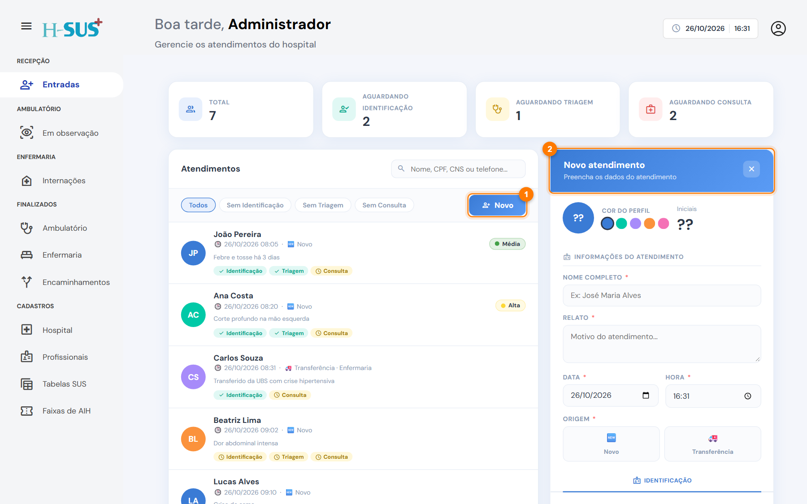
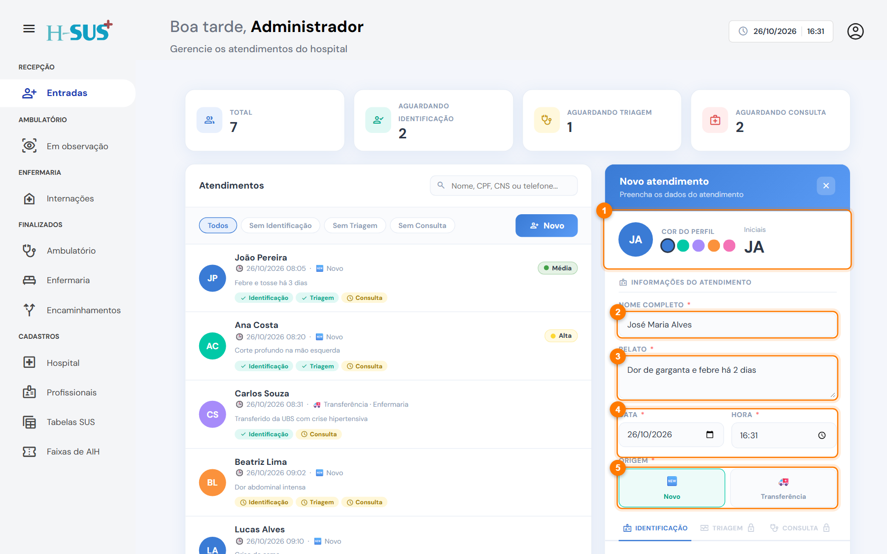
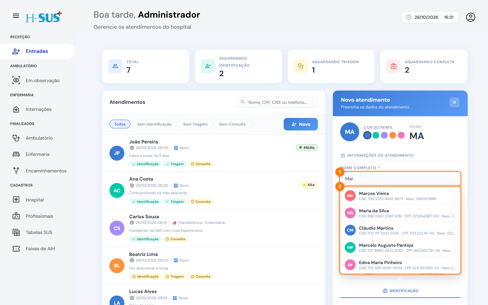
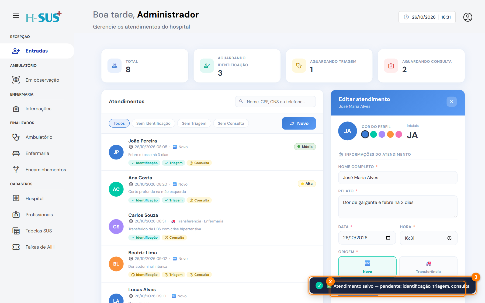

# Novo atendimento

Use a origem **Novo** para o paciente que procurou o hospital por conta própria. O atendimento passa por três etapas, sempre nesta ordem:

| Etapa                             | Quem faz   | Fica concluída quando                           |
| --------------------------------- | ---------- | ----------------------------------------------- |
| [Identificação](identificacao.md) | Recepção   | CNS, nome da mãe e logradouro estão preenchidos |
| [Triagem](triagem.md)             | Enfermagem | A classificação de risco é escolhida            |
| [Consulta](consulta.md)           | Médico     | O encaminhamento é definido                     |

Cada aba só libera depois que a anterior for **salva e concluída**. Enquanto isso, ela aparece com um cadeado.

## Abrir o atendimento



### Clique em Novo

Clique em **Novo** (1). O formulário à direita fica em branco, com o título **Novo atendimento** (2).

<figure><figcaption>
Formulário de novo atendimento aberto
</figcaption></figure>




### Preencha os dados da chegada

1. Se quiser, escolha a **cor do perfil**. As iniciais aparecem sozinhas a partir do nome.
2. Digite o **nome completo**.
3. Escreva o **relato**: o motivo da procura, com as palavras do paciente.
4. Confira a **data e a hora** da chegada. Elas vêm com o momento atual.
5. Em **Origem**, escolha **Novo**.

<figure><figcaption>
Dados da chegada preenchidos
</figcaption></figure>




### Paciente que já veio antes? Use a sugestão

Ao digitar o nome (1), o sistema mostra os pacientes já atendidos (2). Escolha o nome na lista e a **identificação** e as **alergias** são preenchidas sozinhas. O mesmo vale para o CNS e o CPF.

<figure><figcaption>
Sugestões de pacientes já atendidos
</figcaption></figure>




### Salve

Role até o fim do formulário e clique em **Salvar**. O atendimento entra na lista (1), as abas das etapas aparecem (2) e um aviso mostra o que ainda falta (3).

<figure><figcaption>
Atendimento salvo
</figcaption></figure>





Para salvar, bastam nome, relato, data, hora e origem. Assim você registra a chegada rapidamente e completa o resto depois.


Continue em [Identificação](identificacao.md).
