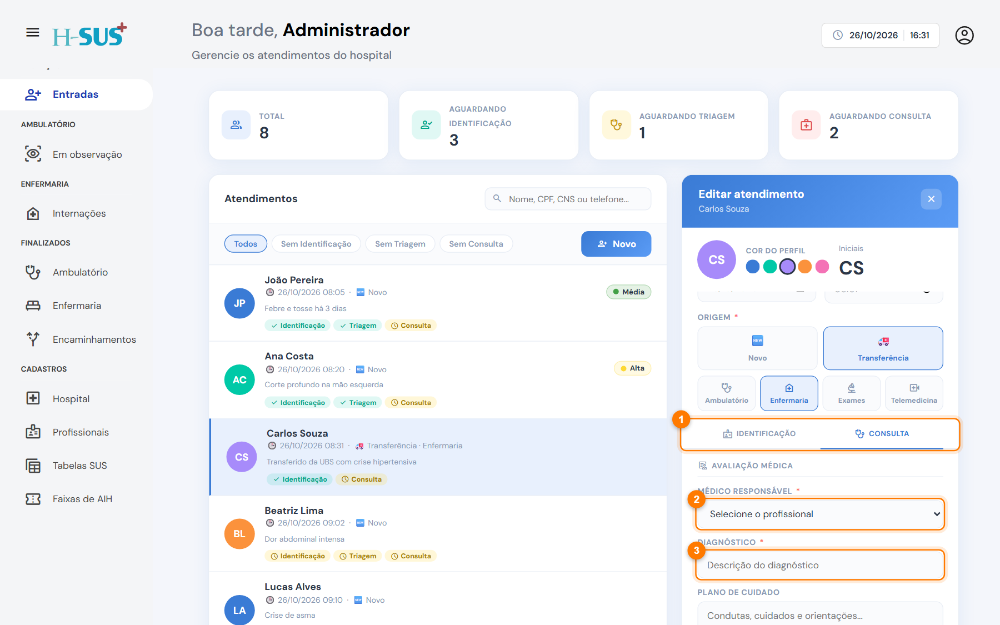

# Para o ambulatório

Destino para o paciente transferido que vai ficar **em observação** no hospital.



### Abra a aba Consulta

Abra o atendimento da transferência e clique na aba **Consulta** (1). Ela libera depois da identificação.

<figure><figcaption>
Consulta de uma transferência
</figcaption></figure>




### Registre o médico e o diagnóstico

Confira o **médico responsável** (2) e preencha o **diagnóstico** (3). Se quiser, escreva o plano de cuidado.



### Salve

Clique em **Salvar**. O paciente sai de Entradas e aparece em [Em observação](../ambulatorio/em-observacao.md).




Na transferência, a consulta fica concluída com **médico responsável** e **diagnóstico** preenchidos (4). O encaminhamento já é o próprio destino, então você não precisa escolhê-lo.



A consulta da transferência é mais simples: não tem prescrição, exames, receita nem atestado.

