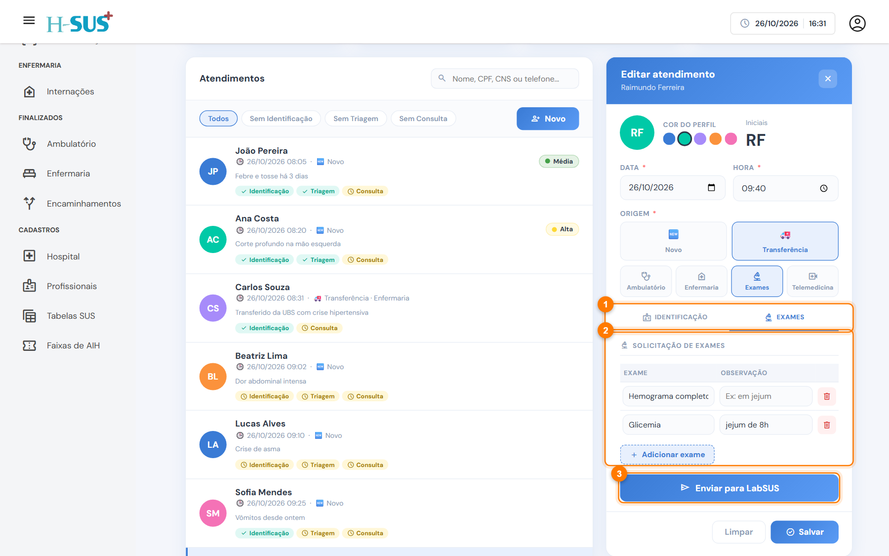
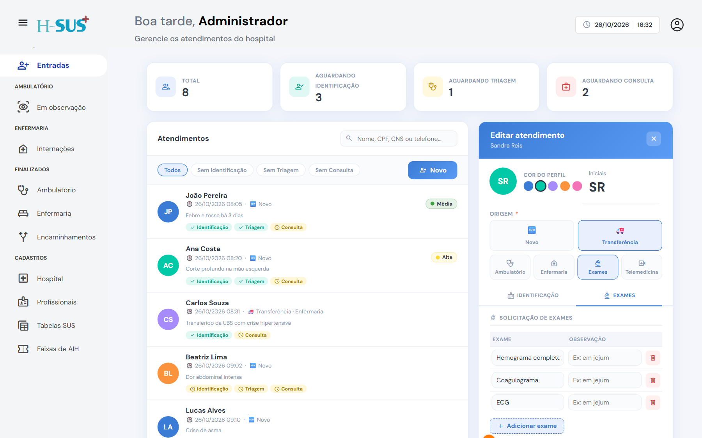

# Para exames

Destino para o paciente que vem ao hospital **só para fazer exames**.



### Abra a aba Exames

Abra o atendimento da transferência e clique na aba **Exames** (1).

<figure><figcaption>
Aba Exames da transferência
</figcaption></figure>




### Liste os exames pedidos

Em **Solicitação de exames** (2), clique em **Adicionar exame** e preencha o exame e a observação. Repita para cada exame da guia.



### Envie para o LabSUS

Clique em **Enviar para LabSUS** (3). O sistema salva o atendimento e registra o envio.

Depois do envio, o botão muda para **Enviado para LabSUS** (1) e mostra a data e a hora (2). O atendimento vai para [Finalizados › Encaminhamentos](../finalizados/encaminhamentos.md).

<figure><figcaption>
Exames enviados ao LabSUS
</figcaption></figure>





É preciso ter ao menos um exame na lista para enviar.



Nesta versão, o sistema registra o envio no atendimento. A transmissão automática dos pedidos para o LabSUS depende da integração configurada no hospital.

