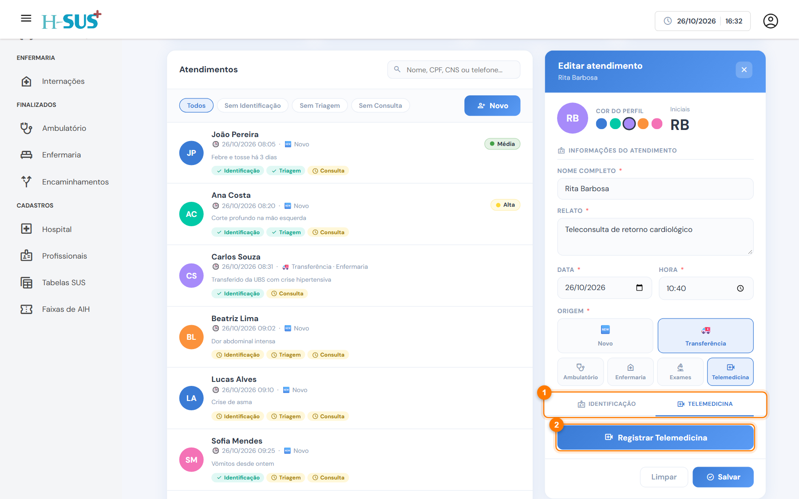
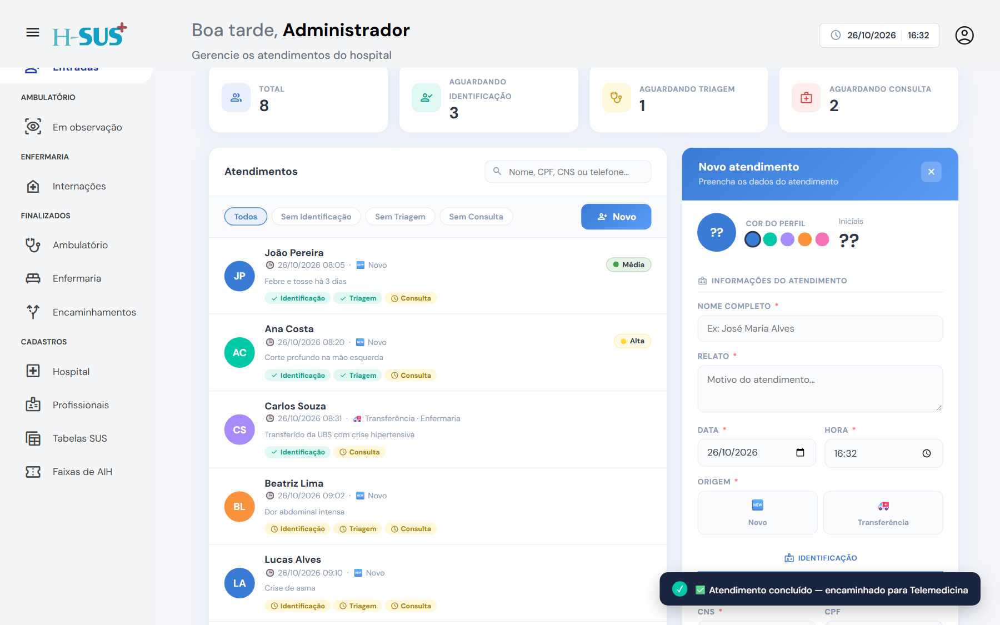

# Para telemedicina

Destino para o paciente que será atendido por **teleconsulta**.



### Abra a aba Telemedicina

Abra o atendimento da transferência e clique na aba **Telemedicina** (1).

<figure><figcaption>
Aba Telemedicina antes do registro
</figcaption></figure>




### Registre a teleconsulta

Clique em **Registrar Telemedicina** (2). O sistema salva o atendimento e marca a data e a hora.

O botão muda para **Telemedicina registrada** (1), com a data e a hora logo abaixo (2), e um aviso confirma. O atendimento vai para [Finalizados › Encaminhamentos](../finalizados/encaminhamentos.md).

<figure><figcaption>
Telemedicina registrada
</figcaption></figure>





Nesta versão, o sistema registra a teleconsulta no atendimento. A ligação com a plataforma de telemedicina depende da integração configurada no hospital.

