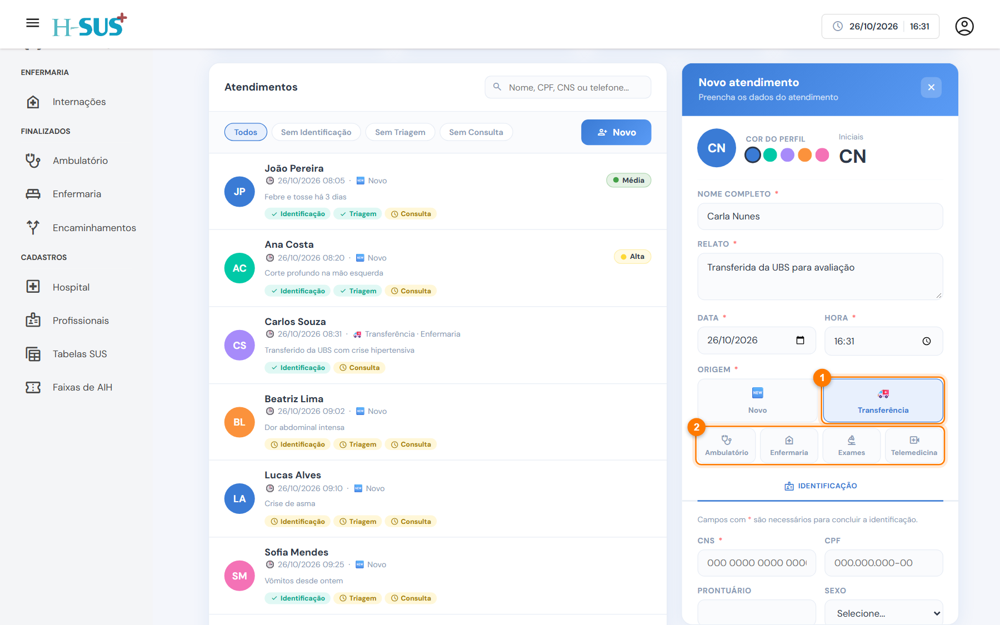

# Transferência

Use a origem **Transferência** para o paciente que chega encaminhado por outra unidade (UBS, UPA ou outro hospital). Nesse caso não há triagem: depois da identificação, o atendimento segue direto para o **destino** escolhido.



### Abra o atendimento e escolha a origem

Em Entradas, clique em **Novo** e preencha nome, relato, data e hora. Em **Origem**, escolha **Transferência** (1) e depois o **destino** (2).

<figure><figcaption>
Origem Transferência e os quatro destinos
</figcaption></figure>




### Faça a identificação

Preencha a aba **Identificação** como no atendimento novo (veja [Identificação](identificacao.md)) e clique em **Salvar**.



### Continue na aba do destino

Com a identificação concluída, a aba do destino libera. Siga a página do destino escolhido.



## Destinos

<table data-view="cards"><thead><tr><th></th><th></th><th data-hidden data-card-cover data-type="files"></th><th data-hidden data-card-target data-type="content-ref"></th></tr></thead><tbody>
<tr><td><strong>Ambulatório</strong></td><td>Observação no hospital. Abas: Identificação → Consulta.</td><td><a href="../imagens/transf-consulta.png">transf-consulta.png</a></td><td><a href="transferencia-ambulatorio.md">transferencia-ambulatorio.md</a></td></tr>
<tr><td><strong>Enfermaria</strong></td><td>Internação. Abas: Identificação → Consulta.</td><td><a href="../imagens/transf-consulta.png">transf-consulta.png</a></td><td><a href="transferencia-enfermaria.md">transferencia-enfermaria.md</a></td></tr>
<tr><td><strong>Exames</strong></td><td>Coleta e envio ao LabSUS. Abas: Identificação → Exames.</td><td><a href="../imagens/transf-exames.png">transf-exames.png</a></td><td><a href="transferencia-exames.md">transferencia-exames.md</a></td></tr>
<tr><td><strong>Telemedicina</strong></td><td>Teleconsulta. Abas: Identificação → Telemedicina.</td><td><a href="../imagens/transf-telemedicina.png">transf-telemedicina.png</a></td><td><a href="transferencia-telemedicina.md">transferencia-telemedicina.md</a></td></tr>
</tbody></table>


Na lista de Entradas, a transferência aparece com 🚑 e o destino, por exemplo "Transferência · Enfermaria".

