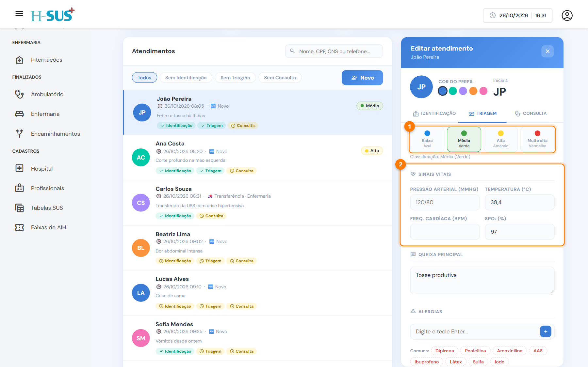
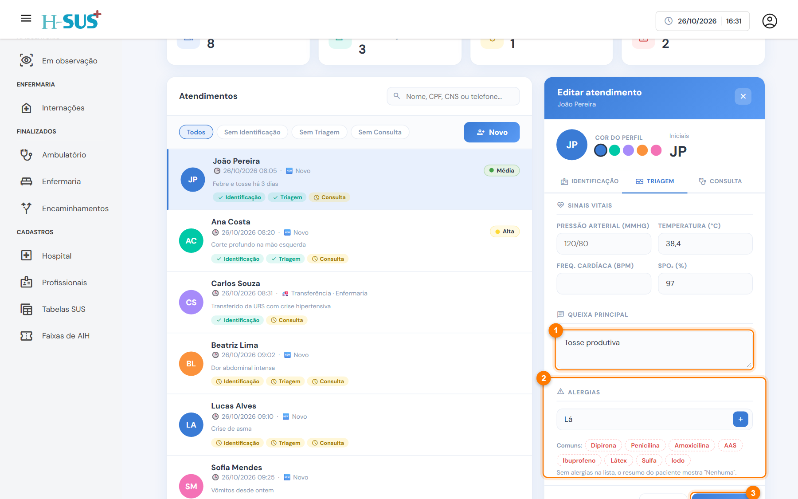

# Triagem

Na triagem, a enfermagem classifica o risco do paciente e registra os primeiros sinais vitais. A classificação aparece na lista de Entradas e ajuda a definir a ordem da consulta.



### Classifique o risco e registre os sinais vitais

Abra o atendimento e clique na aba **Triagem**.

<figure><figcaption>
Classificação de risco e sinais vitais
</figcaption></figure>

1. Escolha a **classificação de risco**:

| Cor         | Prioridade |
| ----------- | ---------- |
| 🔵 Azul     | Baixa      |
| 🟢 Verde    | Média      |
| 🟡 Amarelo  | Alta       |
| 🔴 Vermelho | Muito alta |

2. Registre os **sinais vitais**: pressão arterial, temperatura, frequência cardíaca e saturação (SpO₂).



### Registre a queixa e as alergias

<figure><figcaption>
Queixa principal e alergias
</figcaption></figure>

1. Escreva a **queixa principal** e as observações da triagem.
2. Em **Alergias**, digite cada alergia e tecle **Enter**, ou clique numa das sugestões. Para remover, clique no **×** da etiqueta. Sem alergias na lista, o resumo do paciente mostra "Nenhuma".
3. Clique em **Salvar**.




A triagem fica concluída quando a classificação de risco é escolhida. A partir daí, a aba **Consulta** libera.



As alergias aparecem em destaque na observação, na internação e nas folhas do prontuário. Sempre pergunte ao paciente e registre.

